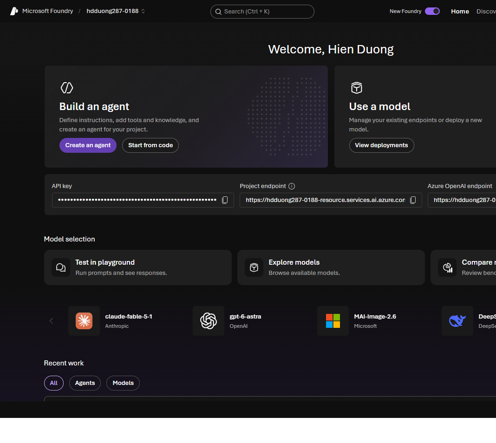
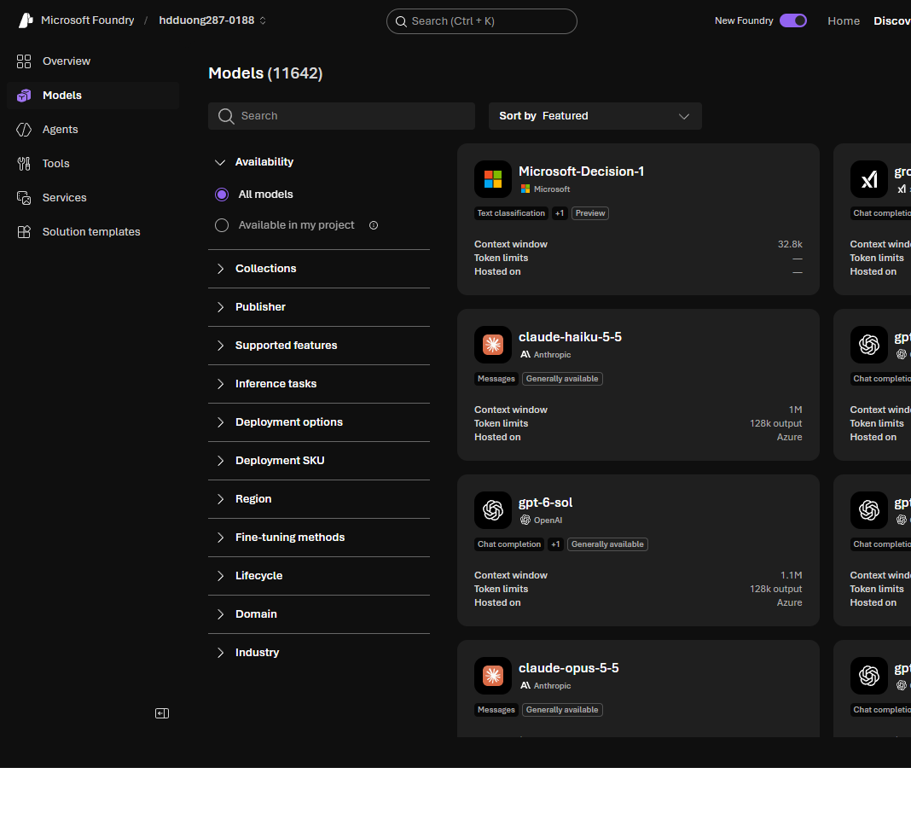

# 03 Microsoft Foundry

[Microsoft Foundry](https://learn.microsoft.com/en-us/training/modules/prepare-azure-ai-development/4-azure-ai-foundry)

- Foundry is the platform for AI development on Azure. You can still create individual AI resources, but Foundry is the recommended way except for the simplest solutions.
- Two ways to work: the **Foundry portal** (`https://ai.azure.com`) and the **Foundry SDK** (scripts and CI/CD).


- A project holds the solution assets. Each project belongs to one Foundry resource. One resource can have several projects, and one of them is the default.
- The resource supplies compute, storage, and AI tools. The project holds the assets for one solution.

Assets in a project:

- **Models.** Deployments from the Foundry model catalog (Microsoft, OpenAI, and others). Reach them through the project endpoint (Foundry APIs) or the Azure OpenAI endpoint (OpenAI APIs).


- **Agents.** A named setup: model, instructions, and tools. Built and called through the Foundry Agent service on the project endpoint.
- **Tools.** Built-ins such as web search and a code interpreter, or custom and third-party tools through MCP. Foundry Tools (language, speech, translation, content understanding) are hosted on the Foundry resource.
- **Knowledge.** Agents use tools to read knowledge stores and ground prompts. Foundry IQ is one MCP connection that fronts several knowledge sources.

In the portal you find, compare, deploy, and test models, create agents, add MCP and Foundry IQ connections, try Foundry Tools, set access, and copy endpoints and keys.

This module uses the current project layout. Classic projects use a hub. The portal is moving to the new UI, and some tasks are still only in the classic portal.

## Lab: create a project and test a model

Lab: [Prepare for an AI development project](https://microsoftlearning.github.io/mslearn-ai-studio/Instructions/Exercises/01-Explore-ai-studio.html). Portal only, no Python.

1. Turn on **New Foundry** and create a project. Pick a region that has the model and the Responses API.
2. **Discover > Models**: deploy `gpt-5.2` with the default settings. Write down the deployment name. Code passes it as `model`.
3. In the playground, set the instructions and send the prompt:

```text
Instructions: You are an AI assistant that can provide information and advice about AI software development.
Prompt: Describe three key considerations for working with Large Language Models for AI application development.
```

4. **Manage** shows the resource with its projects, deployments, and shared connections. The project home page lists the endpoints.

| Detail | Used for |
| --- | --- |
| Project endpoint | Foundry project APIs (agents, knowledge) and models through the project |
| Azure OpenAI endpoint | OpenAI-style calls. The chat lab uses the `/openai/v1/` base URL |
| Deployment name | The `model=` value. It can differ from the catalog name |
| Auth | Key or Microsoft Entra ID. The coding labs use `DefaultAzureCredential` |
