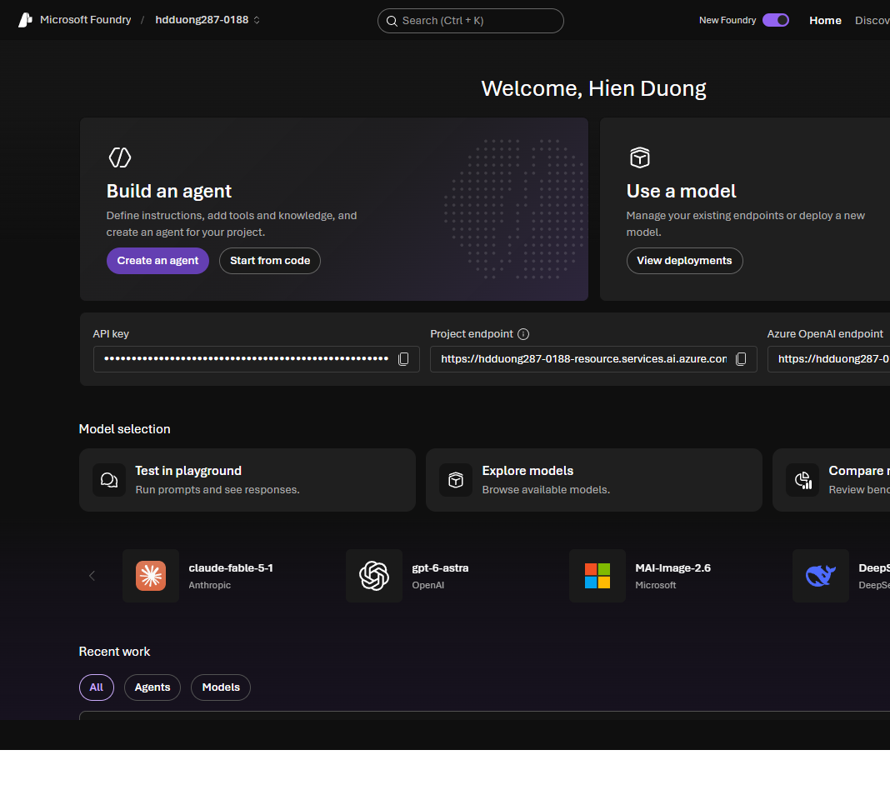
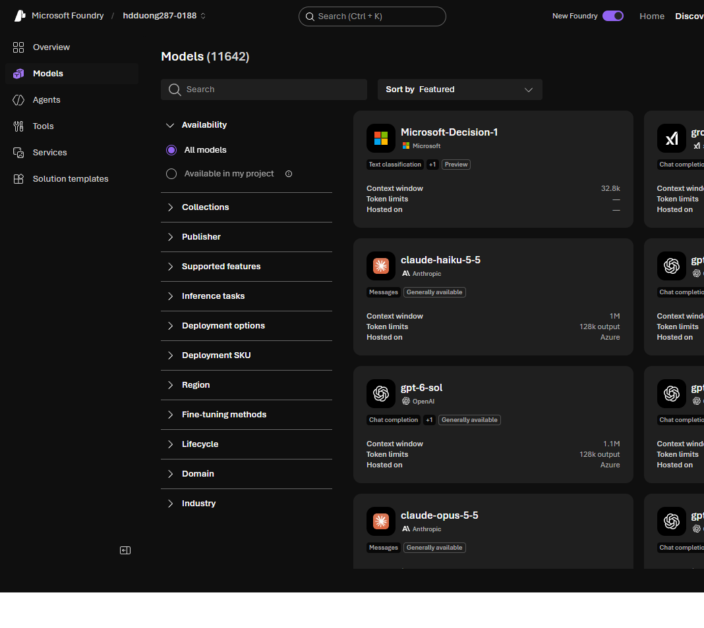

# 03 Microsoft Foundry

[Microsoft Foundry](https://learn.microsoft.com/en-us/training/modules/prepare-azure-ai-development/4-azure-ai-foundry)

- Foundry is the platform for AI development on Azure. You can still create individual AI resources, but Foundry is the recommended way except for the simplest solutions.
- Two ways to work: the **Foundry portal** (`https://ai.azure.com`) and the **Foundry SDK** (scripts and CI/CD).

- A project holds the solution assets. Each project belongs to one Foundry resource. One resource can have several projects, and one of them is the default.
- The resource supplies compute, storage, and AI tools. The project holds the assets for one solution.

Assets in a project:

- **Models.** Deployments from the Foundry model catalog (Microsoft, OpenAI, and others). Reach them through the project endpoint (Foundry APIs) or the Azure OpenAI endpoint (OpenAI APIs).

- **Agents.** A named setup: model, instructions, and tools. Built and called through the Foundry Agent service on the project endpoint.
- **Tools.** Built-ins such as web search and a code interpreter, or custom and third-party tools through MCP. Foundry Tools (language, speech, translation, content understanding) are hosted on the Foundry resource.
- **Knowledge.** Agents use tools to read knowledge stores and ground prompts. Foundry IQ is one MCP connection that fronts several knowledge sources.

In the portal you find, compare, deploy, and test models, create agents, add MCP and Foundry IQ connections, try Foundry Tools, set access, and copy endpoints and keys.

This module uses the current project layout. Classic projects use a hub. The portal is moving to the new UI, and some tasks are still only in the classic portal.
