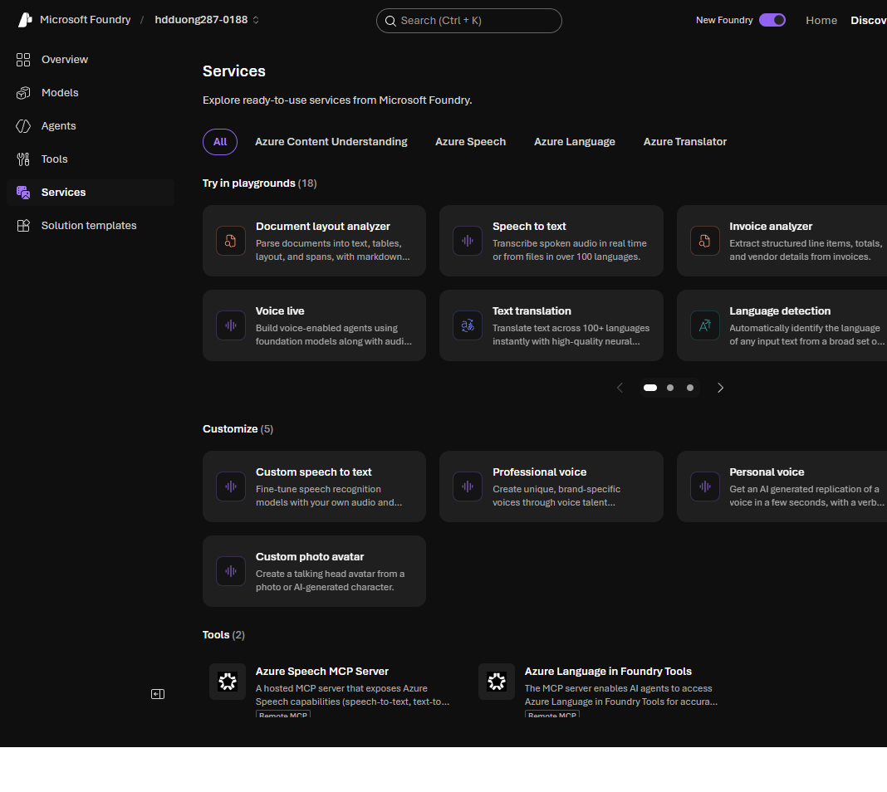

# 04 Foundry Tools

[Foundry Tools](https://learn.microsoft.com/en-us/training/modules/prepare-azure-ai-development/3-azure-ai-services)

- Prebuilt APIs and models for common tasks. Often cheaper and more predictable than doing the same job with a generative agent.
- These were **Azure AI Services**, and before that **Azure Cognitive Services**. Old names still show up in APIs and SDKs.
- You can still create some tools as their own Azure resources. New work should use the tools that come with the Foundry resource.
- Call the tool endpoint on that resource. Auth is the project key or a token. Some tools also have a test UI in the portal.

| Tool | Use it for |
| --- | --- |
| Azure Language | Entity extraction, sentiment, summarization, conversational language, question answering |
| Azure Speech | Speech to text, text to speech, live speech for apps and agents |
| Azure Translator | Text translation across many languages |
| Azure Document Intelligence | Fields from invoices, receipts, and forms. Prebuilt or custom models |
| Azure Content Understanding | Extract data from documents, images, video, and audio |
