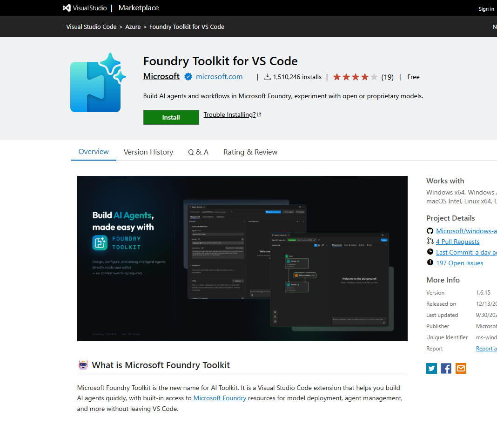

# 05 Developer tools and SDKs

[Developer tools and SDKs](https://learn.microsoft.com/en-us/training/modules/prepare-azure-ai-development/5-tools-and-sdks)

- Portal work is not the whole app. You still write, test, and deploy code.
- Visual Studio fits .NET on Windows. VS Code fits open-source languages. Both can build Azure AI apps.
- In VS Code, the **Foundry Toolkit** extension is the one for Foundry projects. It browses models, agents, connections, and vector stores, deploys models, opens playgrounds, edits declarative and hosted agents (designer and YAML), and generates integration code. On the marketplace the name is **Foundry Toolkit for VS Code**, published by Microsoft. It is the new name for AI Toolkit.

- GitHub is the source control and DevOps side. Visual Studio and VS Code both talk to it. GitHub Copilot is the in-editor assistant.
- Languages called out: C#, Python, Node, TypeScript, Java.

Three libraries to plan for:

- **Foundry SDK** connects to a project and to Foundry assets: agents and Foundry IQ knowledge stores.
- **OpenAI API** is for chat against Foundry models that speak OpenAI syntax.
- **Foundry Tools SDKs** (or the REST APIs) call the individual tools in the subscription.
