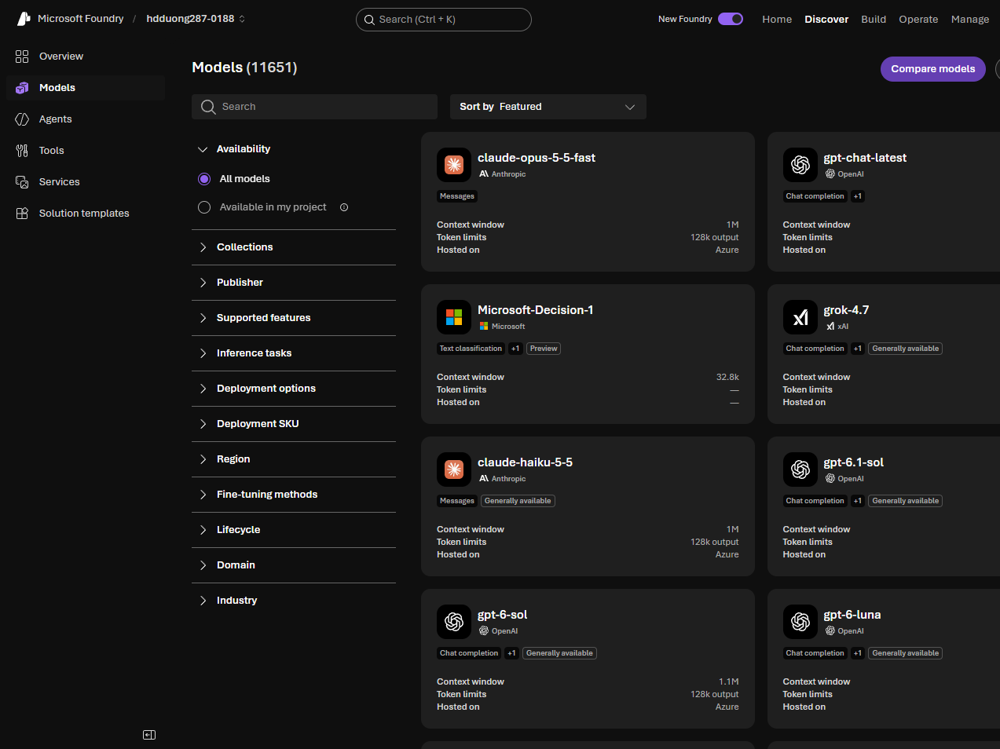

# 02 Explore the model catalog

[Explore the model catalog](https://learn.microsoft.com/en-us/training/modules/model-catalog-evaluate/2-explore-model-catalog?pivots=text)

- The catalog is the place to find and compare models. A model card shows the provider, capabilities, benchmarks, responsible AI notes, and deployment options.
- Two billing groups: models **sold by Azure** (billed on the subscription, including Azure OpenAI) and models **from partners and the community** (their own license and price).
- Filters: collection, publisher, capabilities (reasoning, tool calling, multimodal), inference task, deployment options, fine-tuning method, region, and industry. **All models** is the full catalog. **Available in my project** is only what you already deployed.

- **LLMs** (GPT-5, Mistral Large, Llama 3 70B) for hard reasoning and long context. **SLMs** (Phi-4, Llama 3 8B) when speed and cost matter more. SLMs can run on smaller hardware or at the edge.
- Chat completion models write the reply. Reasoning models (for example Claude Opus) are for math, code, science, and multi-step problems.
- Specialized: embeddings (`text-embedding-3-large` / `small`) for search and RAG, image generation (GPT-image-1), video (Sora 2), image analysis (GPT-4.1), text to speech, speech to text.
- A domain or language model can beat a general model inside that domain.
