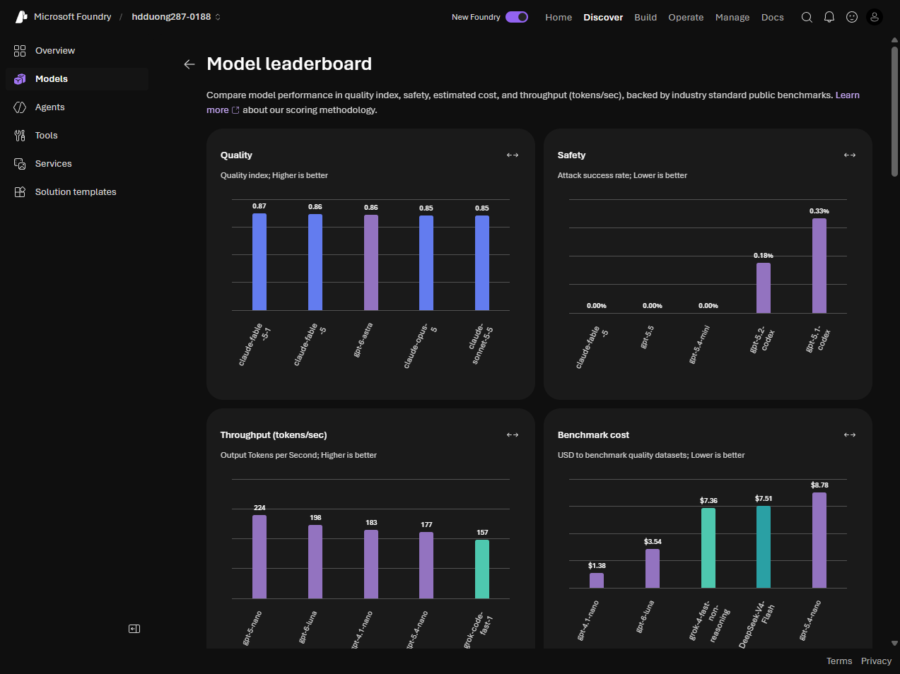

# 03 Select models using benchmarks

[Select models using benchmarks](https://learn.microsoft.com/en-us/training/modules/model-catalog-evaluate/3-select-models-benchmarks?pivots=text)

- Compare on four axes: **quality**, **safety**, **cost**, **performance**. Use the catalog **leaderboard**, or the **Benchmarks** tab on one model card.

- Quality index averages accuracy on reasoning, knowledge, Q&A, math, and code. Scores are 0 to 1. Higher is better. Datasets include Arena-Hard, BIG-Bench Hard, GPQA, HumanEval+ and MBPP+, MATH, MMLU-Pro, IFEval.
- Safety: HarmBench **attack success rate** — lower is safer (cybercrime, misinformation, copyright). ToxiGen F1 — higher means better hate-speech detection. WMDP — higher means more knowledge of bio, cyber, and chemical risks.
- Cost is per **1 million** input tokens and per 1 million output tokens. Estimated cost uses a **3:1** input-to-output ratio. Lower is cheaper.
- Latency: mean, P50, P90, P95, P99, and **time to first token**. Throughput: generated tokens per second (higher is better) and total tokens per second.
- Scenario leaderboards exist for reasoning, coding, math, Q&A, and groundedness. Trade-off charts put two metrics on one plot. Top-right is strong on both. Compare two or three models on benchmarks, context window, endpoints, and features (function calling, structured output, vision).
