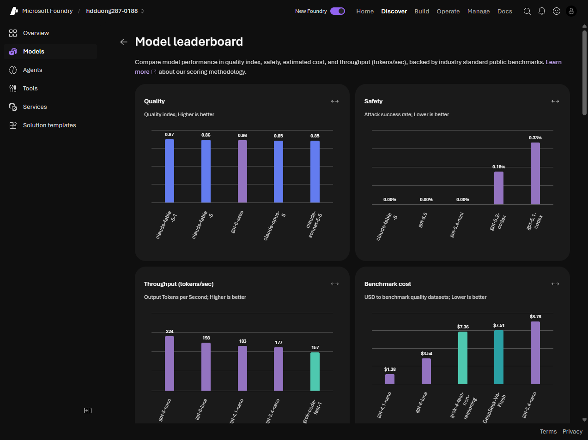

# 03 Select models using benchmarks

[Select models using benchmarks](https://learn.microsoft.com/en-us/training/modules/model-catalog-evaluate/3-select-models-benchmarks?pivots=text)

- Compare on four axes: **quality**, **safety**, **cost**, **performance**. Use the catalog **leaderboard**, or the **Benchmarks** tab on one model card.


- Quality index averages accuracy on reasoning, knowledge, Q&A, math, and code. Scores are 0 to 1. Higher is better. Datasets include Arena-Hard, BIG-Bench Hard, GPQA, HumanEval+ and MBPP+, MATH, MMLU-Pro, IFEval.
- Safety: HarmBench **attack success rate** — lower is safer (cybercrime, misinformation, copyright). ToxiGen F1 — higher means better hate-speech detection. WMDP — higher means more knowledge of bio, cyber, and chemical risks.
- Cost is per **1 million** input tokens and per 1 million output tokens. Estimated cost uses a **3:1** input-to-output ratio. Lower is cheaper.
- Latency: mean, P50, P90, P95, P99, and **time to first token**. Throughput: generated tokens per second (higher is better) and total tokens per second.
- Scenario leaderboards exist for reasoning, coding, math, Q&A, and groundedness. Trade-off charts put two metrics on one plot. Top-right is strong on both, once you check which way each axis is better (cost, latency, and attack success rate are lower-better). Compare two or three models on benchmarks, context window, endpoints, and features (function calling, structured output, vision).
- Benchmarks shortlist. Your own test cases decide.

## Lab: compare two models side by side

Lab: [Explore and compare models](https://microsoftlearning.github.io/mslearn-ai-studio/Instructions/Exercises/02-model-catalog-evaluation.html). Deploy `gpt-5.2` and `gpt-5-mini`. In the playground pick `gpt-5-mini`, then choose `gpt-5.2` under **Compare models**. Send the same prompt to both, then the follow-up:

```text
I have a fox, a chicken, and a bag of grain that I need to take over a river in a boat. I can only take one thing at a time. If I leave the chicken and the grain unattended, the chicken will eat the grain. If I leave the fox and the chicken unattended, the fox will eat the chicken. How can I get all three things across the river without anything being eaten?

Explain your reasoning.
```

Compare accuracy, reasoning, and style. Keep the prompt and instructions the same so the model is the only thing that changes.
