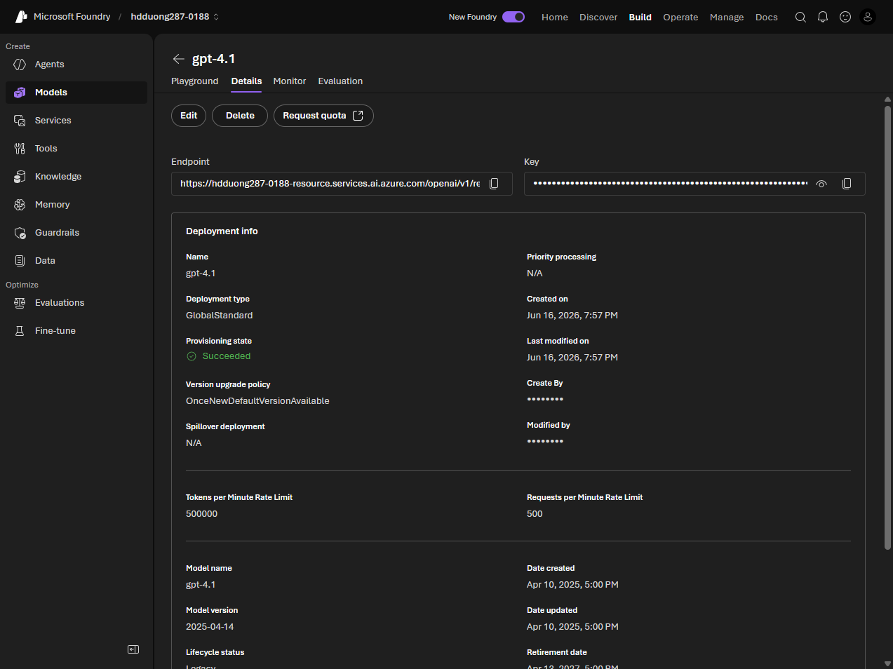

# 04 Deploy models to endpoints

[Deploy models to endpoints](https://learn.microsoft.com/en-us/training/modules/model-catalog-evaluate/4-deploy-models?pivots=text)

- Deploy from Discover > Models. Default settings are the fast path. Custom settings change the type and name.
- The **deployment name** is what the app passes as `model`. It can differ from the catalog id.
- Prefer **Global Standard** when the model supports it. Pay per token, any region, highest quota.

- Global **Provisioned** reserves throughput (PTU). Global **Batch** is about half price for async jobs that can finish within 24 hours.
- **Data Zone** keeps data in a zone (US, EU, APAC). **Regional** stays in one region. Each of those also has Standard, Provisioned, and Batch.
- **Developer** deployments are only for evaluating a fine-tuned model.
- Partner and community models may need a Marketplace agreement. Azure OpenAI models sold by Azure do not.
- Managed compute also needs a VM SKU (quota) and an instance count.
- After deploy, the playground opens. Status should be **Succeeded**. Manage deployments under Build > Models. The details page has the endpoint, key or token, and metrics.
- To call it you need the endpoint (project or OpenAI v1), auth (Entra ID in production, or a key), and the deployment name.
