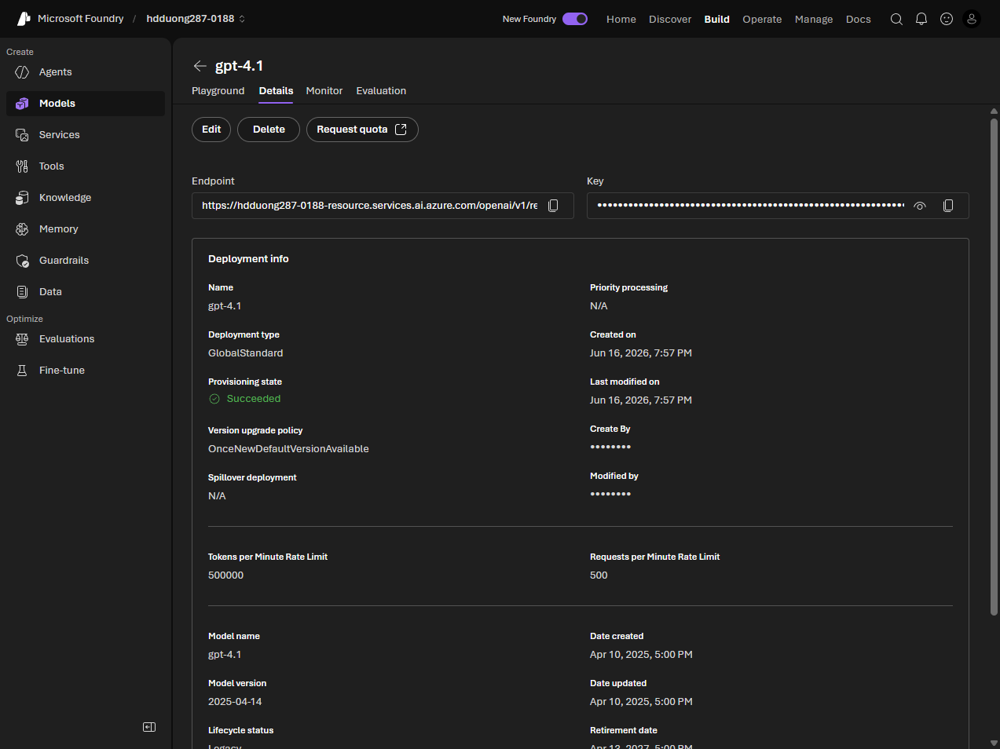

# 04 Deploy models to endpoints

[Deploy models to endpoints](https://learn.microsoft.com/en-us/training/modules/model-catalog-evaluate/4-deploy-models?pivots=text)

- Deploy from **Discover > Models**. Default settings are the fast path. Custom settings change the type and name.
- The **deployment name** is what the app passes as `model`. It can differ from the catalog id.
- Prefer **Global Standard** when the model supports it. Pay per token, lowest price, highest quota, new models first.

## Deployment types

| Where data is processed | Types | Notes |
| --- | --- | --- |
| Global | Standard, Provisioned, Batch | Any Azure region |
| Data Zone | Standard, Provisioned, Batch | Inside the US, EU, or APAC zone |
| Azure geography | Standard, Regional Provisioned | Inside one geography. No Batch here |
| Developer | Fine-tuned model evaluation | 24-hour lifetime, no SLA, no data residency |

- **Standard** is pay per token. **Provisioned** reserves throughput (PTU).
- **Batch** is about half price for async jobs, with a 24-hour target (not a guarantee).
- The Learn unit says Regional stays in one region. The current [deployment types reference](https://learn.microsoft.com/en-us/azure/ai-foundry/foundry-models/concepts/deployment-types) says the geography, possibly across its regions.
- Data at rest always stays in the resource's geography. The table is about inference.

## After deploy

- Partner and community models may need a Marketplace agreement. Azure OpenAI models sold by Azure do not.
- Managed compute also needs a VM SKU (quota) and an instance count.
- After deploy, the playground opens. Status should be **Succeeded**. Manage deployments under Build > Models. The details page has the endpoint, key or token, and metrics.
- To call it you need the endpoint (project or OpenAI v1), auth (Entra ID in production, or a key), and the deployment name.
