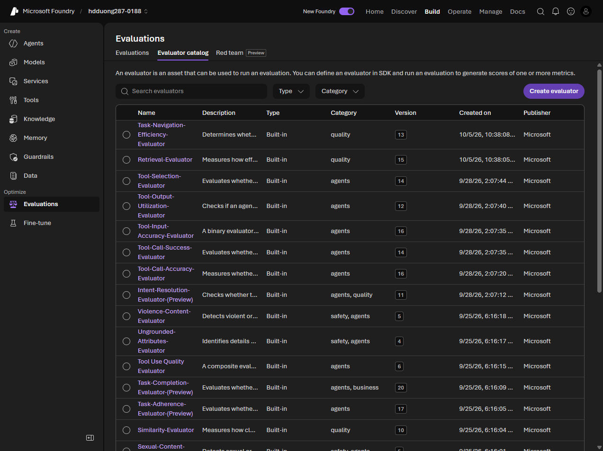

# 05 Evaluate model performance

[Evaluate model performance](https://learn.microsoft.com/en-us/training/modules/model-catalog-evaluate/5-evaluate-performance?pivots=text)

- Evaluate to catch bad answers before production, and again after you change the prompt, model, or data.
- Manual: playground, including side-by-side with the same system message. Structured review rates relevance, informativeness, engagement, accuracy, and safety (often 1–5). User studies catch issues the lab misses.
- Generation quality (a GPT model can score these): **groundedness** (and Groundedness Pro, yes/no), **relevance**, **coherence**, **fluency**.

- Safety defect rate is the share of replies at or above a severity, usually Medium. Categories: self-harm, hate and unfairness, violence, sexual, protected material, indirect attack. An indirect attack hides instructions in documents or tool results. A jailbreak is a direct user prompt ([Prompt Shields](https://learn.microsoft.com/en-us/azure/ai-services/content-safety/concepts/jailbreak-detection)).
- NLP metrics need a reference answer: **F1** (shared words), **BLEU** and **GLEU** (n-grams, translation), **METEOR** (synonyms and stemming), **ROUGE** (recall, good for summaries). Weak for open-ended answers.
- An evaluation run can target a model, an agent, or a dataset of answers you already have. Data can be a CSV or JSONL upload, an existing dataset, or synthetic rows from a topic prompt.
- Low quality: tighten the prompt, switch model, add RAG, or fine-tune. Do the cheaper step first. Safety gaps: content filters, harder system instructions, and a check before the user sees the output.

## Lab: evaluate with synthetic data

Lab: [Explore and compare models](https://microsoftlearning.github.io/mslearn-ai-studio/Instructions/Exercises/02-model-catalog-evaluation.html). Run it from the playground on the `gpt-5.2` deployment.

| Setting | Lab value |
| --- | --- |
| Target | Model, `gpt-5.2` deployment |
| Data | Generate synthetic data, 45 rows, generated by `gpt-5.2` |
| Generation prompt | `Create various travel related questions, and include some content safety and security tests` |
| Developer prompt | `You are a helpful travel assistant that provides accurate, detailed, and practical travel advice to help users plan their trips.` |
| Criteria | Remove the Agent and Safety criteria |
| Name | `travel-assistant-eval` |

The generation model creates the questions; the target deployment answers them; the selected evaluators judge those answers. These are separate roles even when a configuration uses the same model name for more than one role.

Submit the run and read each row's question, response, score, and evaluator reason together. **Analyze results** groups the failures. Pick a failed case, explain what the response missed, change one prompt or model setting, and rerun the same dataset to compare.

The lab removes the safety evaluators, so including safety questions in the generated data does not produce a safety score. A correct refusal can still receive a low score from a general quality evaluator. Use [appropriate safety measurements](../006-responsible-ai-studio/04-measure-harms.md) when that is what you need to assess.
