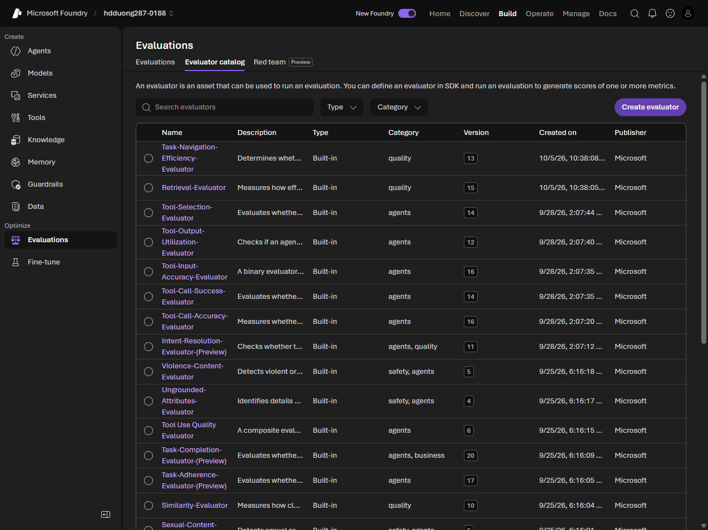

# 05 Evaluate model performance

[Evaluate model performance](https://learn.microsoft.com/en-us/training/modules/model-catalog-evaluate/5-evaluate-performance?pivots=text)

- Evaluate to catch bad answers before production, and again after you change the prompt, model, or data.
- Manual: playground, including side-by-side with the same system message. Structured review rates relevance, informativeness, engagement, accuracy, and safety (often 1–5). User studies catch issues the lab misses.
- Generation quality (a GPT model can score these): **groundedness** (and Groundedness Pro, yes/no), **relevance**, **coherence**, **fluency**.

- Safety defect rate is the share of replies at or above a severity, usually Medium. Categories: self-harm, hate and unfairness, violence, sexual, protected material, indirect attack (jailbreak).
- NLP metrics need a reference answer: **F1** (shared words), **BLEU** and **GLEU** (n-grams, translation), **METEOR** (synonyms and stemming), **ROUGE** (recall, good for summaries). Weak for open-ended answers.
- An evaluation run can target a model, an agent, or a dataset of answers you already have. Data can be a CSV or JSONL upload, an existing dataset, or synthetic rows from a topic prompt.
- Low quality: tighten the prompt, switch model, add RAG, or fine-tune. Do the cheaper step first. Safety gaps: content filters, harder system instructions, and a check before the user sees the output.
