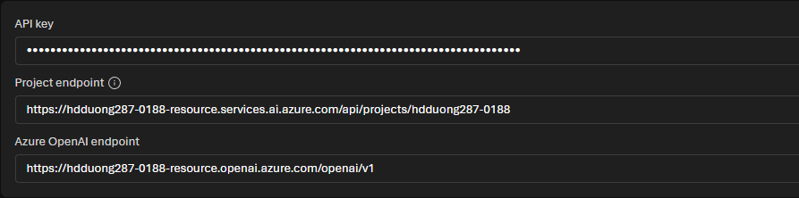
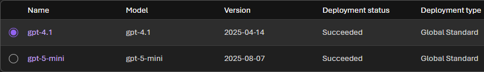

# 03 Choose an endpoint and SDK

[Choose an endpoint and SDK](https://learn.microsoft.com/en-us/training/modules/foundry-sdk/03-microsoft-foundry-sdk?pivots=text)

- Each project has a **project** endpoint and an **Azure OpenAI** endpoint. Both are on the project home page. The key is shown there too. Leave it out of source.


- Foundry SDK (`AIProjectClient`) uses the project endpoint. OpenAI SDK uses the Azure OpenAI endpoint. Both give an OpenAI-compatible client.
- Use the Foundry SDK for agents, evaluations, tracing, connections, datasets, and indexes. Use the OpenAI SDK for plain inference. One app can use both.
- Production auth is **Microsoft Entra ID**. Keys and tokens also work. Do not put keys in source.
- **Responses** for new apps. **Chat Completions** when you need wider model compatibility.
- `model` is the **Name** column on Deployments, not the catalog id. Here the name and the model happen to match (`gpt-4.1`).



## Foundry SDK

```bash
pip install azure-ai-projects azure-identity openai
```

```python
from azure.identity import DefaultAzureCredential
from azure.ai.projects import AIProjectClient

project_endpoint = "https://{resource-name}.services.ai.azure.com/api/projects/<project-name>"
project_client = AIProjectClient(
    credential=DefaultAzureCredential(),
    endpoint=project_endpoint,
)
openai_client = project_client.get_openai_client(api_version="2024-10-21")
```

Run `az login` first. `openai` is required because chat goes through `get_openai_client()`.

## OpenAI SDK

```bash
pip install openai azure-identity
```

```python
from openai import OpenAI
from azure.identity import DefaultAzureCredential, get_bearer_token_provider

token_provider = get_bearer_token_provider(
    DefaultAzureCredential(),
    "https://ai.azure.com/.default",
)
openai_endpoint = "https://{resource-name}.openai.azure.com/openai/v1/"
openai_client = OpenAI(
    base_url=openai_endpoint,
    api_key=token_provider,
)
```

`azure-identity` is only needed for Entra ID. A key comes from `AZURE_OPENAI_API_KEY`. If `OPENAI_BASE_URL` and `OPENAI_API_KEY` are set, `OpenAI()` needs no arguments.

Use `AzureOpenAI` only for a specific API version. That endpoint has no `/openai/v1`, and you pass `api_version`.

## Non-Azure OpenAI model

```python
response = openai_client.responses.create(
    model="DeepSeek-R1-0528",  # deployment name
    input="What are the top 3 benefits of cloud computing? Be concise.",
)
print(response.output_text)
```
