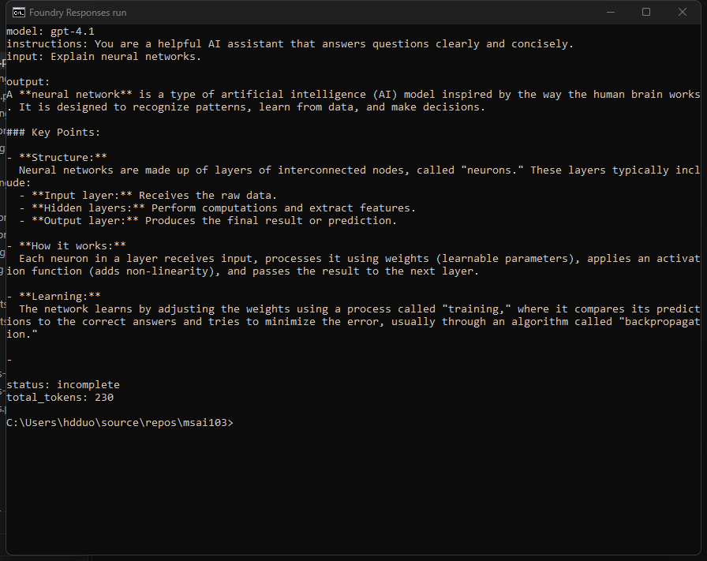

# 04 Responses API

[Generate responses with the Responses API](https://learn.microsoft.com/en-us/training/modules/foundry-sdk/04-responses-api?pivots=text)

- Recommended for new Foundry apps. It combines Chat Completions and Assistants and keeps state across turns.
- Call it from the OpenAI-compatible client (Foundry SDK or OpenAI SDK).
- `input` is the user prompt. `instructions` is the system prompt.
- Read `output_text`, `id`, `status`, `usage.total_tokens`, and `model`.
- `temperature` is 0.0–2.0 (higher is more varied). `max_output_tokens` caps length, reasoning tokens included. `top_p` is the other randomness control. [Reasoning models](https://learn.microsoft.com/en-us/azure/ai-foundry/openai/how-to/reasoning) may reject `temperature` and `top_p`.
- `model` is the deployment name. The same call works for a Foundry direct model such as Phi or DeepSeek, if that model supports Responses.
- Next turn: pass `previous_response_id`. That includes prior context and uses more tokens. Resend `instructions` each turn. They are not carried over.
- Or keep history yourself: `input` is a list of messages, then append `response.output`.
- Load an old turn with `responses.retrieve(response_id)`.
- Stream with `stream=True`. Print `event.delta` when `event.type == "response.output_text.delta"`. The id is on `response.completed`.
- Concurrent calls use `AsyncOpenAI` and `asyncio.gather`. One `await` alone is not faster.

## One reply

These short examples use `openai_client` from [Choose an endpoint and SDK](03-choose-an-endpoint-and-sdk.md). The complete chat program below creates its own client.

```python
# One request: instructions is the system prompt, input the user prompt
response = openai_client.responses.create(
    model="gpt-4.1",  # deployment name
    instructions="You are a helpful AI assistant that answers questions clearly and concisely.",
    input="Explain neural networks.",
    temperature=0.8,  # 0 to 2; higher gives more varied wording
    max_output_tokens=200,  # caps reply length, reasoning tokens included
)
print(response.output_text)
# id for chaining turns, status, and input plus output tokens
print(response.id, response.status, response.usage.total_tokens)
```

In this run the reply hit the 200-token cap, so `status` is `incomplete`.



## Next turn

```python
# Next turn: link the first reply; instructions must be sent again
follow_up = openai_client.responses.create(
    model="gpt-4.1",  # deployment name
    instructions="You are a helpful AI assistant that explains technology concepts clearly.",
    input="Can you give me an example?",
    previous_response_id=response.id,  # earlier turn becomes context
)
print(follow_up.output_text)
```

## Foundry direct model

```python
# Same call for a Foundry direct model; only the deployment changes
response = openai_client.responses.create(
    model="microsoft-phi-4",  # deployment name
    input="What are the benefits of small language models?",
)
print(response.output_text)
```

## Lab: chat app

The [Create a generative AI chat app](https://microsoftlearning.github.io/mslearn-ai-studio/Instructions/Exercises/03-foundry-sdk.html) exercise turns the one-reply call into a conversation. The important addition is state: each response ID becomes the next request's `previous_response_id`. This assembled version of the [official starter](https://github.com/MicrosoftLearning/mslearn-ai-studio/tree/b702dc2fd9f9411b5eb1f86b9259db6515cd9c48/labfiles/foundry-chat/python/chat-app) also skips blank input and closes the client and credential on exit.

### Prepare the client

Create a New Foundry project, deploy `gpt-5.2`, and copy its **Azure OpenAI endpoint** and actual deployment name. This program uses the OpenAI v1 endpoint; the endpoint/SDK distinction is explained in [unit 03](03-choose-an-endpoint-and-sdk.md). Use Python 3.13, VS Code, and Azure CLI. In an activated virtual environment:

```bash
# Lab packages; aiohttp is needed by the async Azure credential
python -m pip install python-dotenv aiohttp azure-identity openai
# Sign in so DefaultAzureCredential can use your account
az login
```

These are the lab's unpinned dependencies. The signed-in account needs access to the deployment. Save `.env` beside `chat-app.py`, substituting your resource and deployment names:

```dotenv
# Azure OpenAI endpoint from the project home page, with /openai/v1/
AZURE_OPENAI_ENDPOINT="https://<resource-name>.openai.azure.com/openai/v1/"
# Deployment name (Name column on Deployments), passed as model
MODEL_DEPLOYMENT="<your-gpt-5.2-deployment-name>"
```

### Connect the turns

Save this complete program as `chat-app.py`:

```python
import os

from azure.identity import DefaultAzureCredential, get_bearer_token_provider
from dotenv import load_dotenv
from openai import OpenAI


def main():
    # Read AZURE_OPENAI_ENDPOINT and MODEL_DEPLOYMENT from .env
    load_dotenv()
    endpoint = os.environ["AZURE_OPENAI_ENDPOINT"]
    deployment = os.environ["MODEL_DEPLOYMENT"]
    instructions = "You are a helpful AI assistant."
    # No previous response yet, so the first turn starts a new chat
    last_response_id = None

    # Sign in with az login; the credential closes when the block ends
    with DefaultAzureCredential() as credential:
        # Supplies Entra tokens to the SDK, so the program holds no key
        token_provider = get_bearer_token_provider(
            credential, "https://ai.azure.com/.default"
        )
        # OpenAI client on the Azure OpenAI v1 endpoint
        with OpenAI(base_url=endpoint, api_key=token_provider) as client:
            # One question per pass until you type quit
            while True:
                prompt = input("Enter a prompt (or 'quit' to exit): ").strip()
                if prompt.lower() == "quit":
                    break
                if not prompt:
                    continue

                # Send this turn's question, linked to the previous turn
                response = client.responses.create(
                    model=deployment,  # deployment name
                    instructions=instructions,  # not carried over by previous_response_id
                    input=prompt,
                    previous_response_id=last_response_id,  # earlier turn as context
                )
                print(response.output_text)
                # Save this turn so the next question follows it
                last_response_id = response.id


if __name__ == "__main__":
    main()
```

Run `python chat-app.py`. Ask `Tell me about the ELIZA chatbot.`, then `How does it compare to modern LLMs?` The second request refers to the first turn through its response ID. To compare a stateless request, remove the `previous_response_id` argument and start again. Use `quit` to exit.

### Stream

Streaming changes **how the response arrives**, not how conversation state works. Inside the loop, replace the entire block from `response = client.responses.create(...)` through **both** `print(response.output_text)` and `last_response_id = response.id` with the following code, keeping the loop's indentation:

```python
# Same request, but the reply arrives as a stream of events
stream = client.responses.create(
    model=deployment,  # deployment name
    instructions=instructions,
    input=prompt,
    previous_response_id=last_response_id,
    stream=True,  # return events as the text is generated
)
for event in stream:
    # A delta is the next piece of text: print it now, no newline
    if event.type == "response.output_text.delta":
        print(event.delta, end="", flush=True)
    # The completed event carries the response id for the next turn
    elif event.type == "response.completed":
        last_response_id = event.response.id
# End the line after the streamed text
print()
```

A failed or interrupted stream needs error handling in an application; partial text alone is not evidence of a completed response.

### Async

Async changes **how the application waits for the network**. The exercise also supplies a `chat-async.py` starter. The complete version below uses the same `.env`, with `azure.identity.aio` and `AsyncOpenAI` together:

```python
import asyncio
import os

from azure.identity.aio import DefaultAzureCredential, get_bearer_token_provider
from dotenv import load_dotenv
from openai import AsyncOpenAI


async def main():
    # Read AZURE_OPENAI_ENDPOINT and MODEL_DEPLOYMENT from .env
    load_dotenv()
    # Async credential from azure.identity.aio; closed when the block ends
    async with DefaultAzureCredential() as credential:
        # Async token function; AsyncOpenAI awaits it before each request
        token_provider = get_bearer_token_provider(
            credential, "https://ai.azure.com/.default"
        )
        # Async client: its API calls are awaited instead of blocking
        async with AsyncOpenAI(
            base_url=os.environ["AZURE_OPENAI_ENDPOINT"],
            api_key=token_provider,
        ) as client:
            # Same chat loop and turn chaining as chat-app.py
            last_response_id = None
            while True:
                # input() blocks the event loop, so turns run one at a time
                prompt = input("Enter a prompt (or 'quit' to exit): ").strip()
                if prompt.lower() == "quit":
                    break
                if not prompt:
                    continue
                # await lets other tasks run while the server works
                response = await client.responses.create(
                    model=os.environ["MODEL_DEPLOYMENT"],  # deployment name
                    instructions="You are a helpful AI assistant.",
                    input=prompt,
                    previous_response_id=last_response_id,
                )
                print(response.output_text)
                last_response_id = response.id


if __name__ == "__main__":
    asyncio.run(main())
```

Save as `chat-async.py` and run `python chat-async.py`. A single awaited request does not by itself make the model faster.

Next, [Chat Completions](05-openai-api.md#lab-swap-in-chat-completions) uses the same authenticated connection but represents conversation history as messages in the application. Delete the exercise's disposable Azure resources when you have finished both versions.
