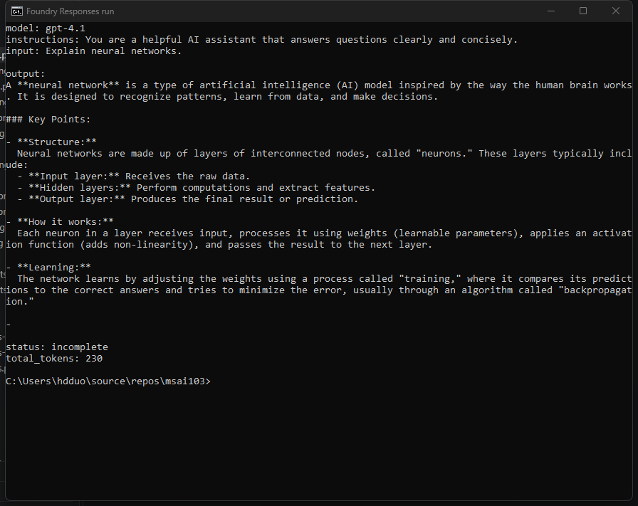

# 04 Responses API

[Generate responses with the Responses API](https://learn.microsoft.com/en-us/training/modules/foundry-sdk/04-responses-api?pivots=text)

- Recommended for new Foundry apps. It combines Chat Completions and Assistants and keeps state across turns.
- Call it from the OpenAI-compatible client (Foundry SDK or OpenAI SDK).
- `input` is the user prompt. `instructions` is the system prompt.
- Read `output_text`, `id`, `status`, `usage.total_tokens`, and `model`.
- `temperature` is 0.0–2.0 (higher is more varied). `max_output_tokens` caps length, reasoning tokens included. `top_p` is the other randomness control. [Reasoning models](https://learn.microsoft.com/en-us/azure/ai-foundry/openai/how-to/reasoning) may reject `temperature` and `top_p`.
- `model` is the deployment name. The same call works for a Foundry direct model such as Phi or DeepSeek, if that model supports Responses.
- Next turn: pass `previous_response_id`. That includes prior context and uses more tokens. Resend `instructions` each turn. They are not carried over.
- Or keep history yourself: `input` is a list of messages, then append `response.output`.
- Load an old turn with `responses.retrieve(response_id)`.
- Stream with `stream=True`. Print `event.delta` when `event.type == "response.output_text.delta"`. The id is on `response.completed`.
- Concurrent calls use `AsyncOpenAI` and `asyncio.gather`. One `await` alone is not faster.

## One reply

```python
response = openai_client.responses.create(
    model="gpt-4.1",  # deployment name
    instructions="You are a helpful AI assistant that answers questions clearly and concisely.",
    input="Explain neural networks.",
    temperature=0.8,
    max_output_tokens=200,
)
print(response.output_text)
print(response.id, response.status, response.usage.total_tokens)
```

In this run the reply hit the 200-token cap, so `status` is `incomplete`.



## Next turn

```python
follow_up = openai_client.responses.create(
    model="gpt-4.1",  # deployment name
    instructions="You are a helpful AI assistant that explains technology concepts clearly.",
    input="Can you give me an example?",
    previous_response_id=response.id,
)
print(follow_up.output_text)
```

## Foundry direct model

```python
response = openai_client.responses.create(
    model="microsoft-phi-4",  # deployment name
    input="What are the benefits of small language models?",
)
print(response.output_text)
```

## Lab: chat app

Lab: [Create a generative AI chat app](https://microsoftlearning.github.io/mslearn-ai-studio/Instructions/Exercises/03-foundry-sdk.html). It uses the `openai` package on the Azure OpenAI v1 endpoint, not the project endpoint.

```bash
pip install python-dotenv aiohttp azure-identity openai
az login
```

`.env`:

```dotenv
AZURE_OPENAI_ENDPOINT="https://<resource-name>.openai.azure.com/openai/v1/"
MODEL_DEPLOYMENT="gpt-5.2"
```

`chat-app.py`:

```python
import os
from azure.identity import DefaultAzureCredential, get_bearer_token_provider
from dotenv import load_dotenv
from openai import OpenAI

load_dotenv()
token_provider = get_bearer_token_provider(
    DefaultAzureCredential(),
    "https://ai.azure.com/.default",
)
client = OpenAI(
    base_url=os.environ["AZURE_OPENAI_ENDPOINT"],
    api_key=token_provider,
)
deployment = os.environ["MODEL_DEPLOYMENT"]
instructions = "You are a helpful AI assistant."
last_response_id = None

while True:
    prompt = input("Enter a prompt (or 'quit' to exit): ").strip()
    if prompt.lower() == "quit":
        break
    response = client.responses.create(
        model=deployment,  # deployment name
        instructions=instructions,
        input=prompt,
        previous_response_id=last_response_id,
    )
    print(response.output_text)
    last_response_id = response.id
```

Ask about ELIZA, then `How does it compare to modern LLMs?` The follow-up works because of `previous_response_id`. Remove it and the second answer has no context.

### Stream

Swap the call and the two lines after it:

```python
stream = client.responses.create(
    model=deployment,  # deployment name
    instructions=instructions,
    input=prompt,
    previous_response_id=last_response_id,
    stream=True,
)
for event in stream:
    if event.type == "response.output_text.delta":
        print(event.delta, end="", flush=True)
    elif event.type == "response.completed":
        last_response_id = event.response.id
print()
```

### Async

`chat-async.py`. Async needs `azure.identity.aio` and `AsyncOpenAI`.

```python
import asyncio
import os
from azure.identity.aio import DefaultAzureCredential, get_bearer_token_provider
from dotenv import load_dotenv
from openai import AsyncOpenAI

async def main():
    load_dotenv()
    async with DefaultAzureCredential() as credential:
        token_provider = get_bearer_token_provider(
            credential,
            "https://ai.azure.com/.default",
        )
        client = AsyncOpenAI(
            base_url=os.environ["AZURE_OPENAI_ENDPOINT"],
            api_key=token_provider,
        )
        last_response_id = None
        while True:
            prompt = input("Enter a prompt (or 'quit' to exit): ").strip()
            if prompt.lower() == "quit":
                break
            response = await client.responses.create(
                model=os.environ["MODEL_DEPLOYMENT"],  # deployment name
                instructions="You are a helpful AI assistant.",
                input=prompt,
                previous_response_id=last_response_id,
            )
            print(response.output_text)
            last_response_id = response.id

asyncio.run(main())
```

The console still waits on `input()`. Async only helps when the app runs several calls at once.
