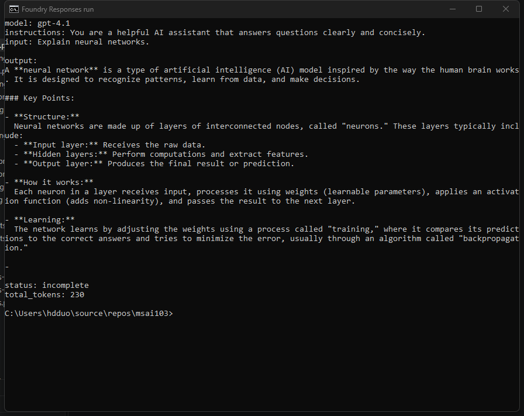

# 04 Responses API

[Generate responses with the Responses API](https://learn.microsoft.com/en-us/training/modules/foundry-sdk/04-responses-api?pivots=text)

- Recommended for new Foundry apps. It combines Chat Completions and Assistants and keeps state across turns.
- Call it from the OpenAI-compatible client (Foundry SDK or OpenAI SDK).
- `input` is the user prompt. `instructions` is the system prompt.
- Read `output_text`, `id`, `status`, `usage.total_tokens`, and `model`.
- `temperature` is 0.0–2.0 (higher is more varied). `max_output_tokens` caps length. `top_p` is the other randomness control.
- `model` is the deployment name. The same call works for a Foundry direct model such as Phi or DeepSeek.
- Next turn: pass `previous_response_id`. That includes prior context and uses more tokens.
- Or keep history yourself: `input` is a list of messages, then append `response.output`.
- Load an old turn with `responses.retrieve(response_id)`.
- Stream with `stream=True`. Print `event.delta` when `event.type == "response.output_text.delta"`. The id is on `response.completed`.
- Concurrent calls use `AsyncOpenAI` and `asyncio.gather`. One `await` alone is not faster.

## One reply

```python
response = openai_client.responses.create(
    model="gpt-4.1",  # deployment name
    instructions="You are a helpful AI assistant that answers questions clearly and concisely.",
    input="Explain neural networks.",
    temperature=0.8,
    max_output_tokens=200,
)
print(response.output_text)
print(response.id, response.status, response.usage.total_tokens)
```

This is that call, run against deployment `gpt-4.1`. `max_output_tokens` is 200, so the reply stops early and `status` is `incomplete`.



## Next turn

```python
follow_up = openai_client.responses.create(
    model="gpt-4.1",  # deployment name
    instructions="You are a helpful AI assistant that explains technology concepts clearly.",
    input="Can you give me an example?",
    previous_response_id=response.id,
)
print(follow_up.output_text)
```

## Foundry direct model

```python
response = openai_client.responses.create(
    model="microsoft-phi-4",  # deployment name
    input="What are the benefits of small language models?",
)
print(response.output_text)
```
