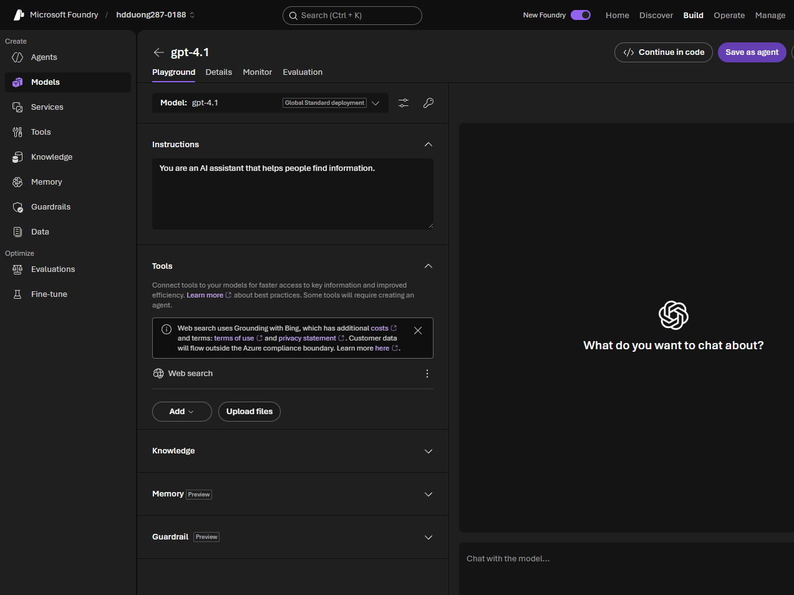

# 04 Use the web_search tool

[Use the web_search tool](https://learn.microsoft.com/en-us/training/modules/use-generative-ai-tools/04-web-search?pivots=text)

- The model searches the public web when the answer depends on current facts. It writes the query, reads pages, and answers from those sources.
- In the playground this tool is **Grounding with Bing**. It can add cost, and customer data may leave the Azure compliance boundary.


- Say "latest" or a date range when freshness matters. Ask for official sources on high-stakes facts, then check them yourself.
- The same prompt can return a different answer later. Some regions or policies block web access. Search adds latency and tokens.

```python
response = openai_client.responses.create(
    model="gpt-4.1",  # deployment name
    instructions="You are an AI assistant. Use web search when current information is required.",
    input="What are three major announcements from Microsoft Build this week?",
    tools=[
        {"type": "web_search"},
    ],
)
print(response.output_text)
```

## Apply web search to the travel assistant

In the [tools exercise](https://microsoftlearning.github.io/mslearn-ai-studio/Instructions/Exercises/04a-use-own-data.html), the assistant answers for Margie's Travel. Ask about tourist activities in New York next month in the playground, then attach **Web search** and repeat the question. Keep the instructions and question the same to isolate the effect of retrieval.

The API equivalent is the `{"type": "web_search"}` entry in the example above. It gives the model permission to retrieve web information; the response's `web_search_call` items and citations let you check whether it actually searched. An answer that sounds current is not enough evidence.

Web information does not establish what Margie's Travel sells. [The file-search lesson](05-file-search.md#lab-brochures-plus-web-search) adds the company's brochures to the same application and explains how its instructions guide the choice between the two sources.
