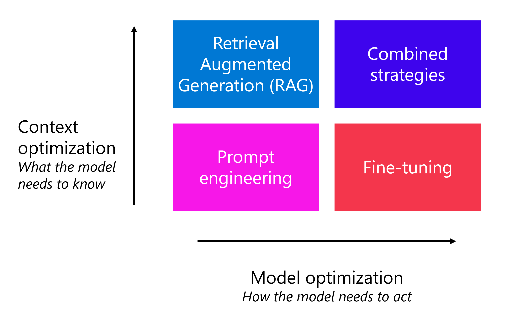

# 01 Introduction

[Introduction](https://learn.microsoft.com/en-us/training/modules/optimize-generative-ai-model-performance/1-introduction?pivots=text)

- A base model may not fit the app as-is. The travel-agency example needs the company's tone, accurate facts about its own hotels, and a consistent format.
- The fixes range from quick and cheap to slow and costly, and they can be combined.

Diagram from [Microsoft Learn](https://learn.microsoft.com/en-us/training/modules/optimize-generative-ai-model-performance/1-introduction?pivots=text) (CC BY 4.0).

- **Context optimization**, what the model needs to know: move up from prompt engineering to **RAG**.
- **Model optimization**, how the model needs to act: move right from prompt engineering to **fine-tuning**.
- Prompt engineering is the starting point on both axes. Need both? Combine RAG and fine-tuning. The trade-offs are in [05](05-compare-combine-strategies.md).
