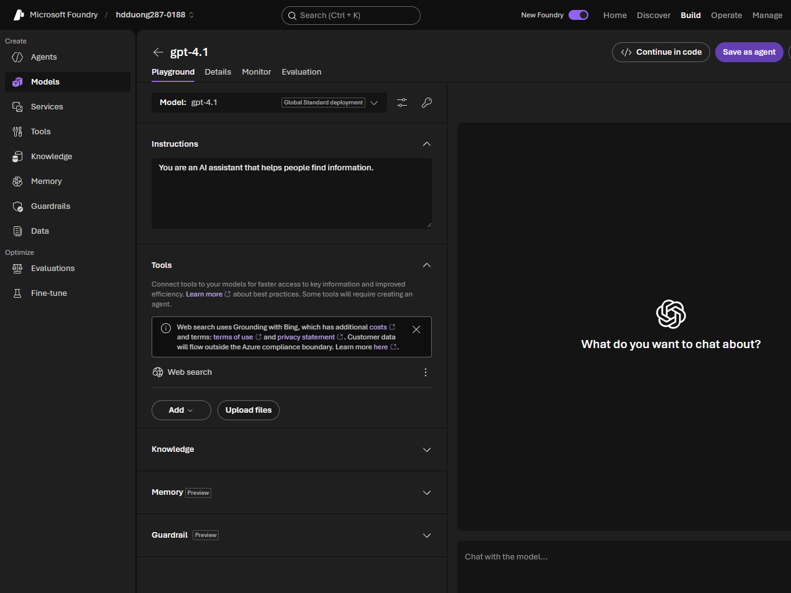

# 02 Optimize model output with prompt engineering

[Optimize model output with prompt engineering](https://learn.microsoft.com/en-us/training/modules/optimize-generative-ai-model-performance/2-prompt-engineering?pivots=text)

- First optimization. No extra training or index. A prompt still does not guarantee the model obeys it.
- Pieces: **system** (role, tone, format, limits), **user**, **assistant** (prior replies), and **examples**. In the playground the system text is the **Instructions** box.

- System-message checklist: role, boundaries, output format, and what to do when unsure.
- Patterns: persona, a format template, chain of thought (for non-reasoning models; reasoning models already do the steps), few-shot versus zero-shot.
- Separate instructions from source text with `---`, headings, or XML tags. If instructions are ignored, repeat them at the end. Later text weighs more (recency bias).
- Change **temperature** or **top_p**, not both. Low temperature (about 0.2) for facts. Higher (about 0.7) for creative text.
- Stop here when you only need tone, format, or instructions. It cannot supply private or post-cutoff facts, and long prompts cost tokens.
