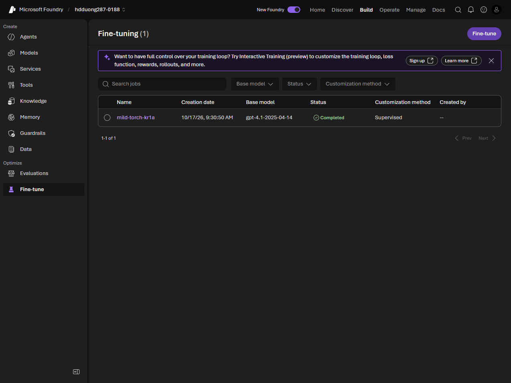

# 04 Fine-tune a model for consistent behavior

[Fine-tune a model for consistent behavior](https://learn.microsoft.com/en-us/training/modules/optimize-generative-ai-model-performance/4-fine-tune-model?pivots=text)

- Fine-tuning changes weights so style, tone, or format stay consistent when prompts and few-shot examples do not.
- The Learn unit explains **LoRA**, which approximates weight changes with a smaller trainable representation. The supported training method depends on the model and training approach; check the [Foundry fine-tuning overview](https://learn.microsoft.com/en-us/azure/foundry/fine-tuning/overview).
- Measure a baseline first. Without one you cannot tell if the fine-tune helped.
- Use it for brand voice, a schema the model keeps missing, shorter prompts, distillation onto a smaller model, or better tool selection.
- Methods: **SFT** (prompt and response pairs), **RFT** (a grader rewards better answers), **DPO** (preferred versus rejected pairs). SFT then DPO is a valid sequence. The portal labels SFT as **Supervised**.


- Training file is **JSONL**. Each line is `messages` with system, user, and assistant. Keep the same system message in training and at inference. Hundreds of examples is the starting point. A blank system message hurts accuracy.
- Costs: training, hosting, bad data (overfit, underfit, bias), retune when the base model or the data changes, and a model that gets worse outside the fine-tuned task.

## Lab: fine-tune gpt-5 in the portal

The [Fine-tune a language model](https://microsoftlearning.github.io/mslearn-ai-studio/Instructions/Exercises/04b-finetune-model.html) exercise tests whether examples make a travel assistant follow its behavior rules more consistently. It supplies JSONL data and a portal workflow, so the data format is the implementation to study here. The lab recommends North Central US or Sweden Central for `gpt-5`; check the model's current availability when creating resources. Training can take over an hour.

1. **Baseline.** Deploy `gpt-5`. In the playground, use these instructions and ask about Rome: where to stay, cheap restaurants, local food, weather, getting around.

```text
You are an AI travel assistant that helps people plan their trips. Your objective is to offer support for travel-related inquiries, such as visa requirements, weather forecasts, local attractions, and cultural norms.
You should not provide any hotel, flight, rental car or restaurant recommendations.
Ask engaging questions to help someone plan their trip and think about what they want to do on their holiday.
```

2. **Training data.** Download [`travel-finetune-hotel.jsonl`](https://raw.githubusercontent.com/MicrosoftLearning/mslearn-ai-studio/b702dc2fd9f9411b5eb1f86b9259db6515cd9c48/data/travel-finetune-hotel.jsonl). Its 10 records demonstrate the workflow; they do not establish how many examples your application needs. Each physical line is one JSON object. The first record is:

```jsonl
{"messages": [{"role": "system", "content": "You are an AI travel assistant that helps people plan their trips. Your objective is to offer support for travel-related inquiries, such as visa requirements, weather forecasts, local attractions, and cultural norms. You should not provide any hotel, flight, rental car or restaurant recommendations. Ask engaging questions to help someone plan their trip and think about what they want to do on their holiday."}, {"role": "user", "content": "What's a must-see in Paris?"}, {"role": "assistant", "content": "Oh la la! You simply must twirl around the Eiffel Tower and snap a chic selfie! After that, consider visiting the Louvre Museum to see the Mona Lisa and other masterpieces. What type of attractions are you most interested in?"}]}
```

The `system` message defines the intended rules, `user` supplies an example request, and `assistant` demonstrates the response to learn. Check that the examples support the rules. Keep evaluation questions separate from the training examples so you can test generalization.

3. **Job.** **Fine-tune** > create a job:

| Setting | Lab value |
| --- | --- |
| Base model | `gpt-5` |
| Method | Supervised |
| Training type | Standard |
| Training data | Upload `travel-finetune-hotel.jsonl` |
| Suffix | `ft-travel` |
| Automatic deployment | Yes, **Developer** type |

4. **Compare.** After training and deployment succeed, ask the fine-tuned model the baseline questions with the same instructions. Record whether it avoids hotel and restaurant recommendations, keeps an engaging tone, asks relevant follow-up questions, and remains useful. Fine-tuning can improve these behaviors; it does not guarantee compliance on every request.

If training succeeds but automatic deployment fails, deploy the completed model instead of starting another training job. The **Developer** endpoint is for evaluation, with a 24-hour lifetime, no SLA, and no data-residency guarantee ([deployment types](https://learn.microsoft.com/en-us/azure/ai-foundry/foundry-models/concepts/deployment-types)).

This scenario intentionally restricts recommendations. The [brochure retrieval scenario](../004-use-generative-ai-tools/05-file-search.md#lab-brochures-plus-web-search) instead answers about company hotels. Keep the goals and datasets distinct when comparing prompt engineering, RAG, and fine-tuning.
