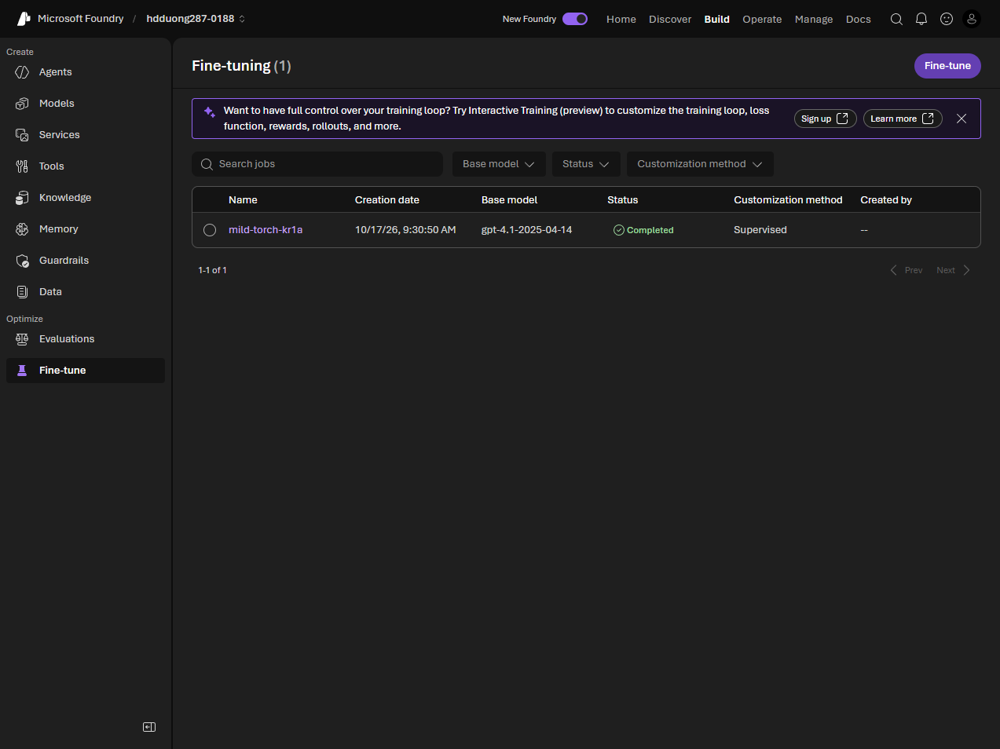

# 04 Fine-tune a model for consistent behavior

[Fine-tune a model for consistent behavior](https://learn.microsoft.com/en-us/training/modules/optimize-generative-ai-model-performance/4-fine-tune-model?pivots=text)

- Fine-tuning changes weights so style, tone, or format stay consistent when prompts and few-shot examples do not.
- Foundry uses **LoRA**: it updates a small set of parameters, not the whole model.
- Measure a baseline first. Without one you cannot tell if the fine-tune helped.
- Use it for brand voice, a schema the model keeps missing, shorter prompts, distillation onto a smaller model, or better tool selection.
- Methods: **SFT** (prompt and response pairs), **RFT** (a grader rewards better answers), **DPO** (preferred versus rejected pairs). SFT then DPO is a valid sequence. The portal labels SFT as **Supervised**.


- Training file is **JSONL**. Each line is `messages` with system, user, and assistant. Keep the same system message in training and at inference. Hundreds of examples is the starting point. A blank system message hurts accuracy.
- Costs: training, hosting, bad data (overfit, underfit, bias), retune when the base model or the data changes, and a model that gets worse outside the fine-tuned task.

```json
{"messages": [{"role": "system", "content": "You are a friendly travel advisor for Margie's Travel."}, {"role": "user", "content": "What's a good beach destination in Europe?"}, {"role": "assistant", "content": "For a beautiful European beach experience, consider the Algarve in southern Portugal."}]}
```
