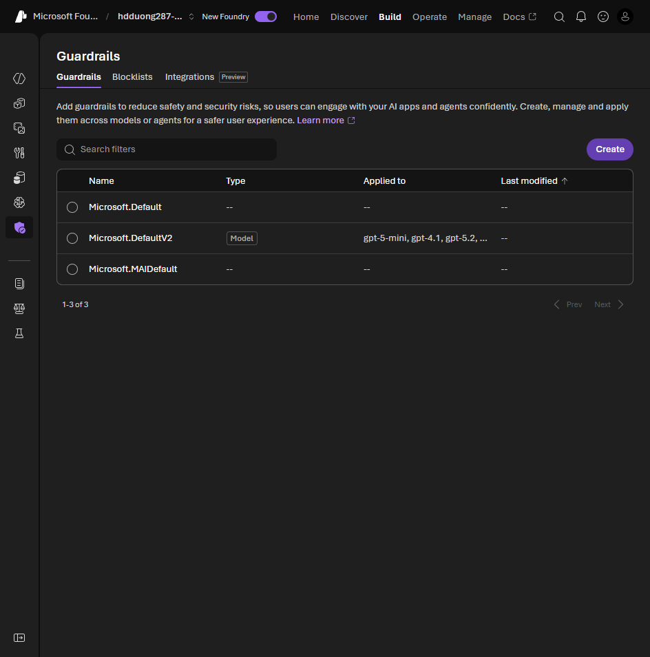

# 02 Plan a responsible generative AI solution

[Plan a responsible generative AI solution](https://learn.microsoft.com/en-us/training/modules/responsible-ai-studio/2-plan-responsible-ai?pivots=text)

Four stages, in this order. They line up with the NIST AI Risk Management Framework.

1. **Map** harms that matter for this solution.
2. **Measure** how often those harms show up in the output.
3. **Mitigate** at more than one layer, and tell users about the remaining risk.
4. **Manage** the release and the day-to-day operation.

The module exercise works in **Build > Guardrails**. Each deployment already has `Microsoft.DefaultV2`. **Create** starts a custom guardrail, which is the mitigate step. The [lab steps](05-mitigate-harms.md#lab-raise-the-content-filters) are in unit 05.

