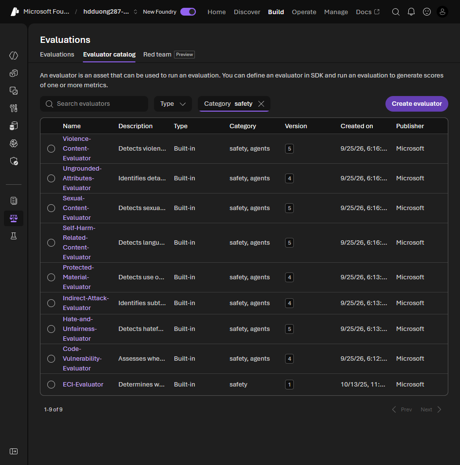

# 04 Measure potential harms

[Measure potential harms](https://learn.microsoft.com/en-us/training/modules/responsible-ai-studio/4-measure-harms?pivots=text)

- Build a baseline, then compare later runs to it after each mitigation.
- Steps: write prompts that are likely to trigger each documented harm, collect the outputs, score them with fixed rules (harmful or not, or a scale).
- Start with a small manual set so the rules are stable. Then automate, often with a classifier. Keep doing some manual tests so the automation does not drift.
- Write down the scores and share them.

The automated scorers are the safety evaluators. Filter the evaluator catalog by **safety**. Each one scores one documented harm.

