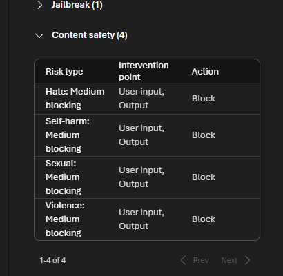

# 05 Mitigate potential harms

[Mitigate potential harms](https://learn.microsoft.com/en-us/training/modules/responsible-ai-studio/5-mitigate-harms?pivots=text)

Four layers. After a change, measure again against the baseline.

1. **Model.** Pick a model that matches the job. A classifier does not need a large generative model. Fine-tune so answers stay in scope.
2. **Safety system.** Foundry guardrails. Content filters use four categories — hate and fairness, sexual, violence, self-harm — and four severities: safe, low, medium, high. The default guardrail blocks Hate, Self-harm, Sexual, and Violence at **Medium** on user input and on output. Task-adherence keeps an agent on the user's intent. Prompt shields (jailbreak) look for attempts to override the system prompt.

3. **System message and grounding.** Behavior rules, grounded prompts, and RAG from trusted data.
4. **User experience.** Limit what the user can send, validate input and output, and document what the system can and cannot do and which harms can still get through.
