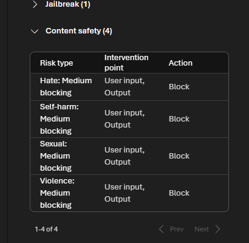
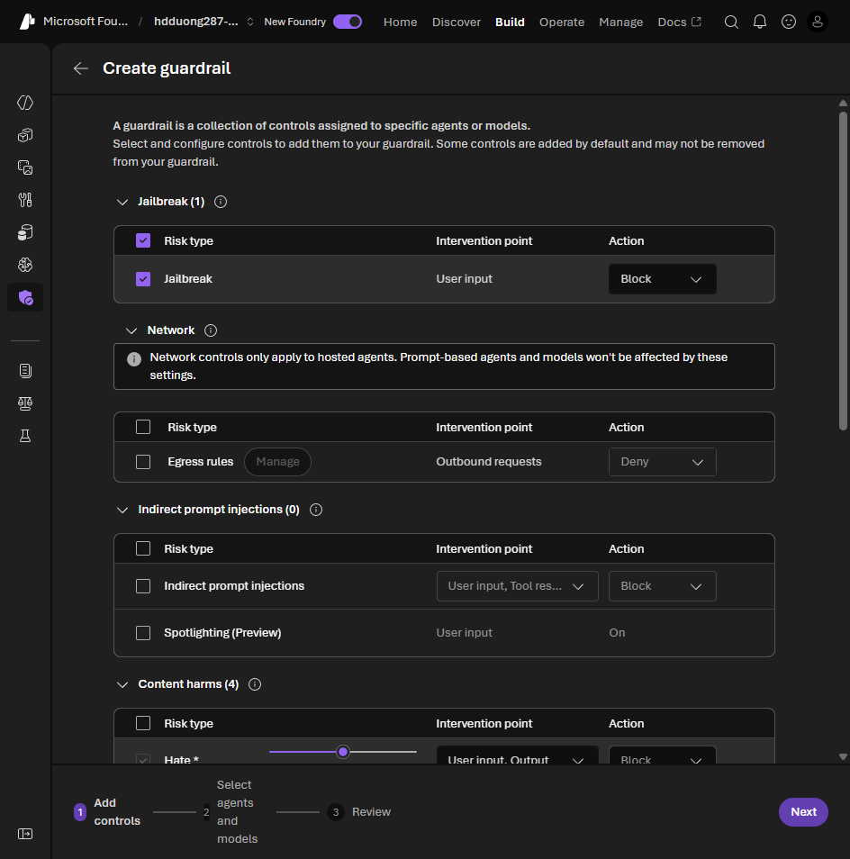

# 05 Mitigate potential harms

[Mitigate potential harms](https://learn.microsoft.com/en-us/training/modules/responsible-ai-studio/5-mitigate-harms?pivots=text)

Four layers. After a change, measure again against the baseline.

1. **Model.** Pick a model that matches the job. A classifier does not need a large generative model. Fine-tune so answers stay in scope.
2. **Safety system.** Foundry guardrails. Content filters use four categories — Hate, Sexual, Violence, and Self-harm — and four severities: safe, low, medium, high. The default guardrail blocks Hate, Self-harm, Sexual, and Violence at **Medium** on user input and on output. Task-adherence keeps an agent on the user's intent. Prompt shields (jailbreak) look for attempts to override the system prompt.

A new guardrail also has the attack controls: **Jailbreak** on user input, **Indirect prompt injections** on tool results, and **Network** egress rules, which only apply to hosted agents.

3. **System message and grounding.** Behavior rules, grounded prompts, and RAG from trusted data.
4. **User experience.** Limit what the user can send, validate input and output, and document what the system can and cannot do and which harms can still get through.

## Lab: raise the content filters

The [Apply guardrails to prevent harmful output](https://microsoftlearning.github.io/mslearn-ai-studio/Instructions/Exercises/06-Explore-content-filters.html) exercise applies the safety-system layer. First record [the baseline in unit 04](04-measure-harms.md#establish-the-guardrail-baseline). This exercise uses the portal; it has no separate SDK program.

1. Open **Build > Guardrails > Create**. Under **Add controls > Risk**, set **Hate**, **Violence**, **Sexual**, and **Self-harm** to **Highest blocking**. Confirm **OK** when replacing an existing filter.
2. Choose **Next**, then **Models**; attach the guardrail to the same `gpt-5.2` deployment used for the baseline and submit.
3. Verify the deployment association, then send the same three prompts again and compare the outcomes you recorded.

**Highest blocking** is the more restrictive setting; it does not mean blocking only the highest-severity content. Attaching the guardrail matters because an application calling another deployment will not exercise this configuration.

| Observation | Interpretation |
| --- | --- |
| Ordinary text declining the request | The model refused; check filter results separately |
| Service reports a content-filter block | The configured filter stopped input or output |
| Same refusal before and after | The model may have already refused without the new filter |
| Benign first-aid use is blocked | Investigate a false positive and the trade-off with useful responses |

The useful result is evidence about what changed for these cases. Feed the findings back into [measurement](04-measure-harms.md) and keep monitoring after release as described in [unit 06](06-operate-responsibly.md). Remove the exercise's disposable resources when you finish.
