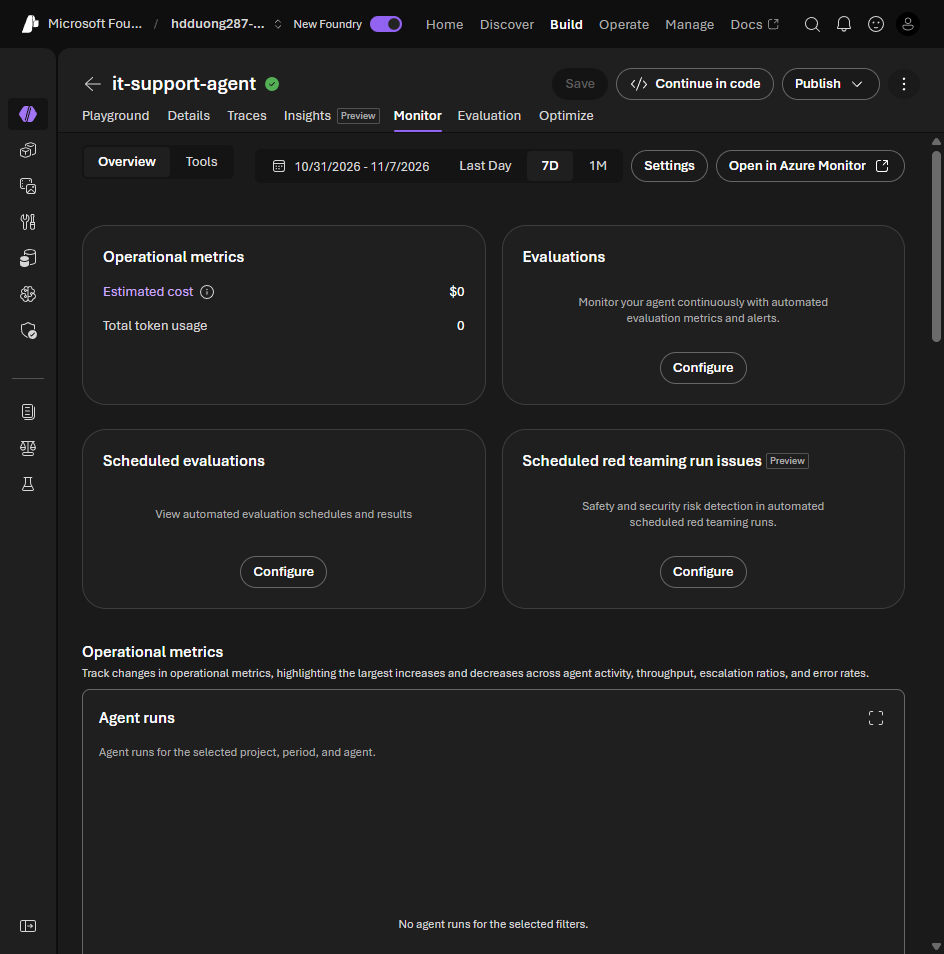

# 06 Manage a responsible generative AI solution

[Manage a responsible generative AI solution](https://learn.microsoft.com/en-us/training/modules/responsible-ai-studio/6-operate-responsibly?pivots=text)

- Before release, get legal, privacy, security, and accessibility review.
- Ship to a small group first.
- Have an incident plan (including how long a response takes), a rollback plan, a way to block a harmful reply immediately, and a way to block a user, app, or IP.
- Let users report output that is wrong, incomplete, harmful, or offensive.
- Collect telemetry for satisfaction and gaps. It has to follow privacy law and the organization's privacy promises.

In Foundry the operate step is the agent **Monitor** tab: cost, token use, continuous evaluation, scheduled evaluations, and scheduled red teaming. Runs and Gen AI errors are below.

