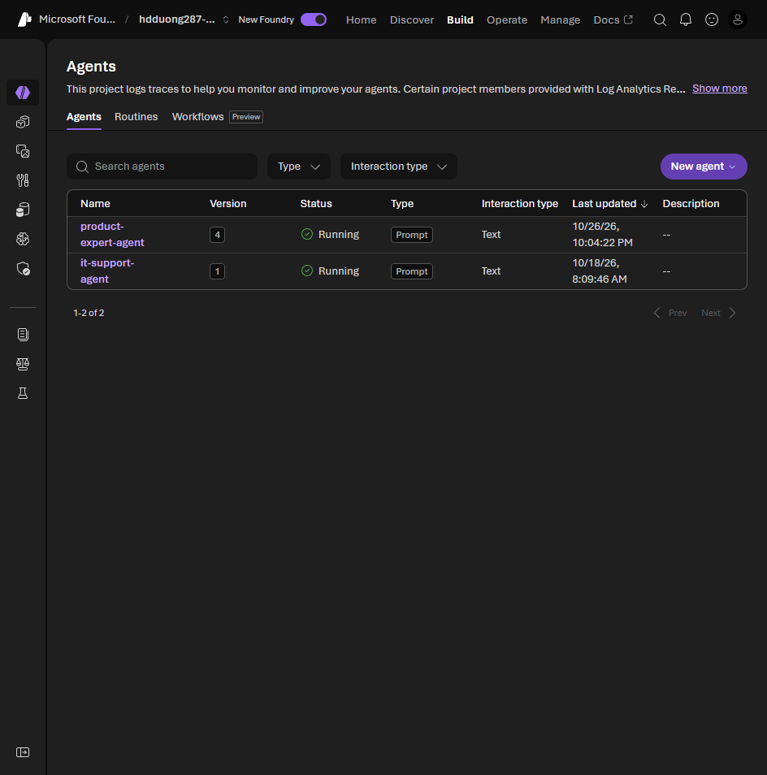

# 02 Understand AI agents and Microsoft Foundry Agent Service

[Understand AI agents and Microsoft Foundry Agent Service](https://learn.microsoft.com/en-us/training/modules/develop-ai-agents-azure-vs-code/2-understand-ai-agents-foundry?pivots=text)

- An agent uses a model plus tools to decide and act. A chat model only writes text.
- Useful because it automates routine work, scales without adding people, and stays available. Examples on the exam: personal productivity, research, sales, customer service, developer agents.
- Security risks: data leakage, prompt injection, privilege escalation, data poisoning, a compromised plugin, an action nobody reviewed, missing logs, model inversion.
- Mitigations: RBAC and least privilege, prompt filtering, human approval for sensitive actions, logs, audit of third-party tools, retrain when data drifts.
- Foundry Agent Service is managed. You do not run the compute. It calls tools, stores conversation state, and applies content filters.
- **Declarative** agents are configuration. A prompt agent is one model, instructions, and tools. A workflow agent is multi-agent YAML. A **hosted** agent is your container, and Foundry runs it. This module is the prompt agent.

## Follow one agent through the module

The [portal and VS Code exercise](https://microsoftlearning.github.io/mslearn-ai-agents/Instructions/Exercises/01-build-agent-portal-and-vscode.html) uses `it-support-agent` throughout these lessons. Its model interprets a request, while its tools supply evidence or perform analysis:

| Request | Capability | What to check |
| --- | --- | --- |
| What is the password reset policy? | File Search over `IT_Policy.txt` | The answer agrees with the uploaded policy |
| When did CPU usage exceed 80%? | Code Interpreter over `system_performance.csv` | The numbers match the CSV |
| Create a memory-usage chart. | Code Interpreter generates a file | The client downloads the chart artifact |

[Unit 04](04-build-agent-azure-portal.md#lab-it-support-agent) configures this behavior in the portal. [Unit 08](08-test-deploy-integrate.md#lab-client-chat-with-the-portal-agent) calls the saved agent by name; the client does not need to repeat its model, instructions, or hosted-tool definitions on every turn.
