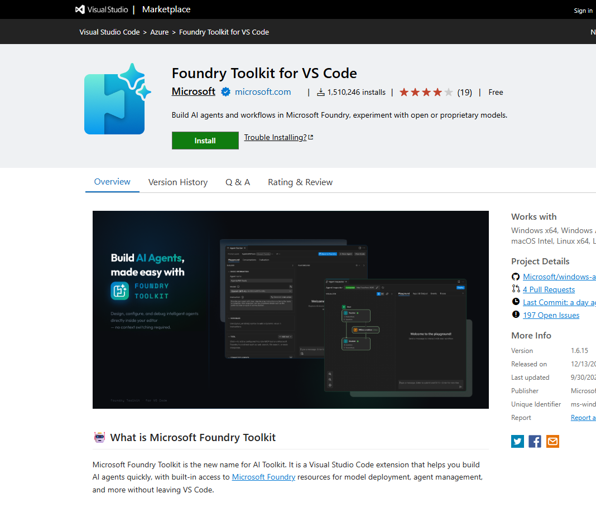

# 03 Explore development approaches

[Explore development approaches](https://learn.microsoft.com/en-us/training/modules/develop-ai-agents-azure-vs-code/3-explore-development-approaches?pivots=text)

- Portal (`https://ai.azure.com`) for a quick prototype, visual setup, and a shared view of agents. No local install.
- Foundry Toolkit in VS Code for Git, YAML, and working next to the app. The panel has three groups:
  - **Resources:** deployed models, declarative agents, hosted agents, connections, vector stores.
  - **Tools:** model catalog, model playground, agent playgrounds, local visualizer, deploy hosted agents.
  - **Help and Feedback.**


- Same flow either way: connect to the project, create the agent, set instructions, add tools, test in a playground, iterate, deploy, call it from the app.
- Required: a Foundry project and a deployed model. Optional later: Azure AI Search, Storage, Key Vault, Functions, Foundry IQ.
- Portal for exploration and reviews. VS Code for the code that ships. Teams often use both.

The exercise uses the portal to save the agent and a Python client to call it. The connection fragment below shows the SDK relationship: `AIProjectClient` manages project resources, and `get_openai_client()` provides the Responses and Conversations APIs for that project. Complete local setup is in [unit 05](05-set-up-vs-code.md#prepare-the-python-client); the runnable application is in [unit 08](08-test-deploy-integrate.md#lab-client-chat-with-the-portal-agent).

```python
from azure.ai.projects import AIProjectClient
from azure.identity import DefaultAzureCredential

project_client = AIProjectClient(
    credential=DefaultAzureCredential(),
    endpoint="https://{resource-name}.services.ai.azure.com/api/projects/<project-name>",
)
openai_client = project_client.get_openai_client()
# Use this client for conversations and responses in unit 08.
```

Use the **project endpoint** ending in `/api/projects/<project-name>`. A bare model endpoint does not identify the project that owns `it-support-agent`. Choosing the portal or VS Code changes how you edit the configuration; it does not create a different kind of agent for the Python client.
