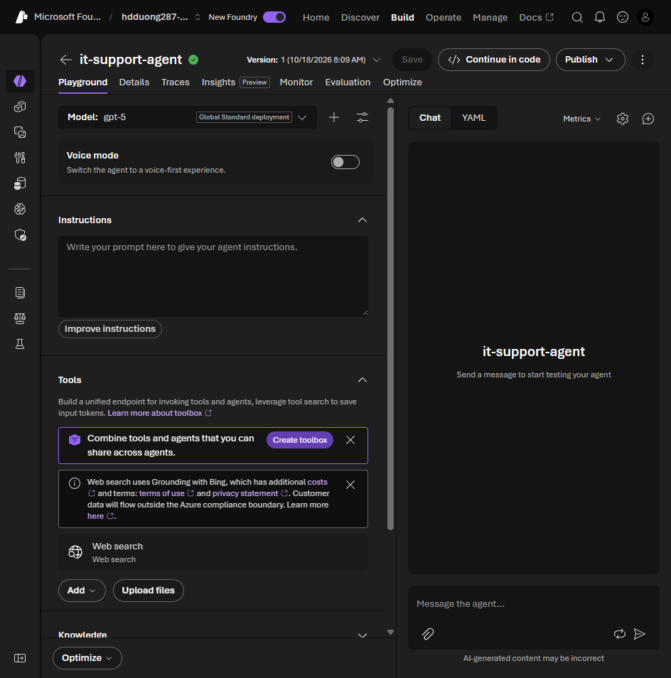

# 04 Build your first agent in Microsoft Foundry

[Build your first agent in Microsoft Foundry](https://learn.microsoft.com/en-us/training/modules/develop-ai-agents-azure-vs-code/4-build-agent-azure-portal?pivots=text)

- Portal path: `https://ai.azure.com`, open the project, **Build > Agents**, **Create**.
- You set the name, a description, and a **deployed** model. The dropdown only lists deployments in this project.
- Instructions are the system prompt. Temperature and top p are on the same screen. Unit 06 is the exam detail for those numbers.
- **Playground** keeps the session history, so you can test more than one turn before you deploy.
- **Tools** (also **Build > Tools**) has three groups: **Configured** (Code Interpreter, File Search), **Catalog** (Bing, Azure AI Search, SharePoint, MCP), **Custom** (your OpenAPI spec).
- **Save** stores the agent in the project. After that you call it with the Foundry SDK or the Responses endpoint in unit 08.



## Lab: it-support-agent

Lab: [Build AI agents with portal and VS Code](https://microsoftlearning.github.io/mslearn-ai-agents/Instructions/Exercises/01-build-agent-portal-and-vscode.html). Create `it-support-agent` with these instructions:

```text
You are an IT Support Agent for Contoso Corporation.
Help employees with technical issues and IT policy questions.
Use the uploaded policy documentation for policy answers.
Be professional and helpful. If you don't know, admit it and suggest IT support.
Collect the required details before proposing a support ticket.
```

| Tool | File from the lab | Used for |
| --- | --- | --- |
| File search | `IT_Policy.txt` | Policy answers |
| Code interpreter (+ Files) | `system_performance.csv` | Metrics and charts |

Wait for indexing, then test both tools in the playground:

```text
What's the policy for password resets?
Analyze the system performance data and identify when CPU usage exceeded 80%.
Create a line chart showing memory usage over time.
What are the average, minimum, and maximum disk usage values?
```

The Python client for the same agent is in [08](08-test-deploy-integrate.md#lab-client-chat-with-the-portal-agent).
