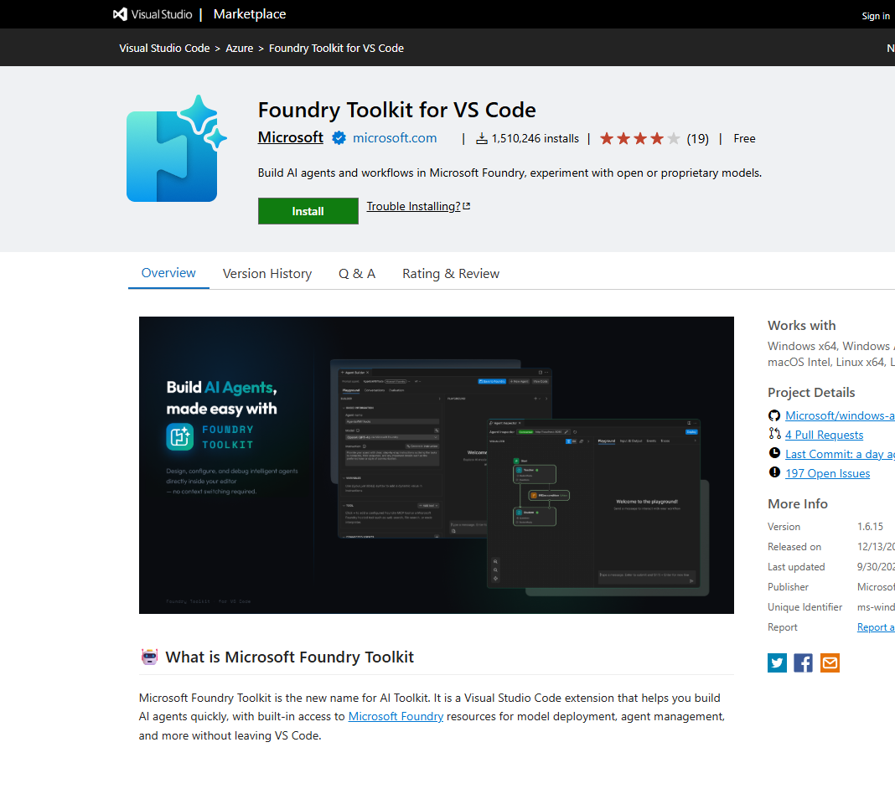

# 05 Set up Visual Studio Code for agent development

[Set up Visual Studio Code for agent development](https://learn.microsoft.com/en-us/training/modules/develop-ai-agents-azure-vs-code/5-set-up-vs-code?pivots=text)

- Extension name in the marketplace: **Foundry Toolkit for VS Code**. After install, its icon is on the activity bar.


- Current exercise route: **Foundry Toolkit > Microsoft Foundry Resources > Set Default Project**, then select your project. If sign-in is unavailable there, sign in through the Azure extension and return to the toolkit. Labels can vary by extension release.
- The panel then shows agents, deployments, connections, and vector stores for that project.
- An agent needs a deployment. In **Resources > Model deployments**, the **+** button asks for a deployment name, a model version, and capacity. The deployment name is what the agent YAML uses as `model.id`.
- Agents created in the portal show up here. **Save to Foundry** writes the YAML back to the project.

After the toolkit is connected, the exercise reads the agent the portal already saved.

```python
agent = project_client.agents.get(agent_name="it-support-agent")
print(agent.name, agent.id)
```
