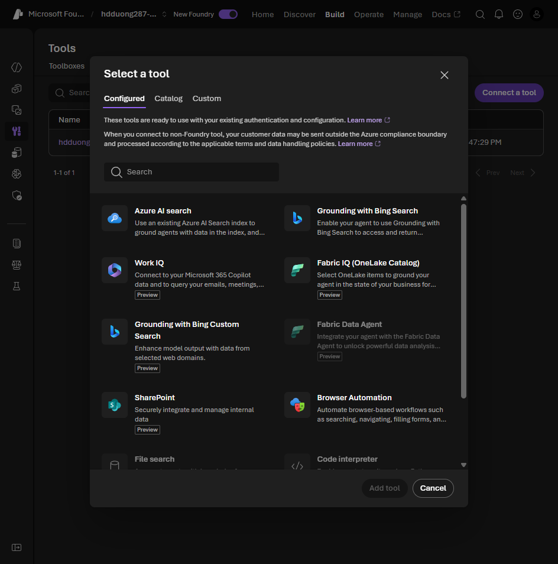
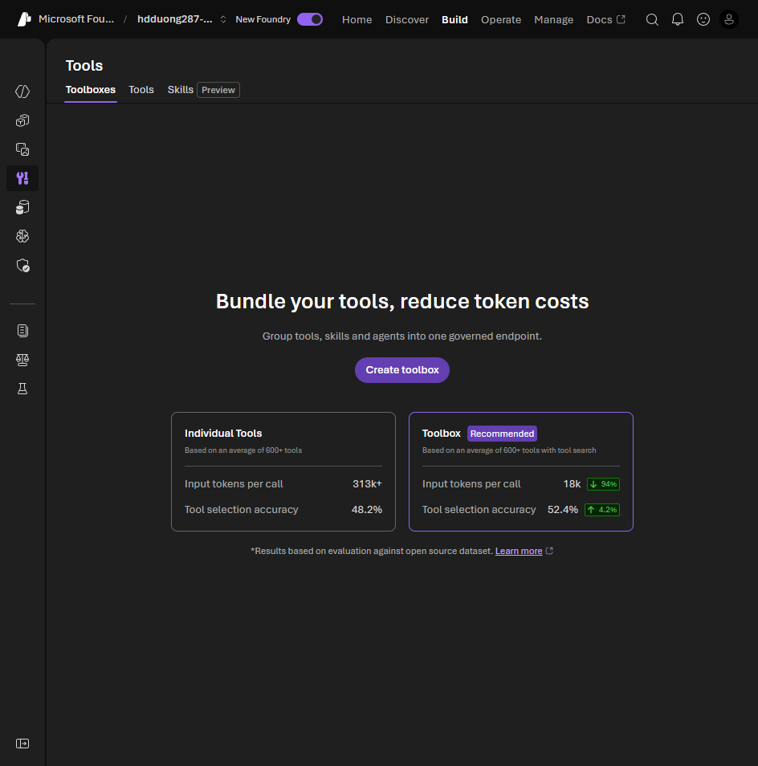

# 07 Extend agent capabilities with tools

[Extend agent capabilities with tools](https://learn.microsoft.com/en-us/training/modules/develop-ai-agents-azure-vs-code/7-extend-agent-capabilities?pivots=text)

- Foundry runs the tool loop: the model picks a tool, the service calls it, the result goes back into the reply. You do not write that loop for a declarative agent. Function tools and MCP approvals are the exceptions: your client answers those.
- Catalog groups: **Configured**, **Catalog**, **Custom**. Same three groups as unit 04.


- Built-ins to know: Code Interpreter (sandboxed Python), File Search (a vector store of your files), Bing grounding (live web, with citations), Azure AI Search (an index you already have), OpenAPI 3.0 (an external HTTP API).
- Also in the catalog: Browser Automation, Computer Use, Image Generation, SharePoint, Fabric, Deep Research, Agent-to-Agent, Memory.
- MCP servers sit in **Catalog**. Remote is the production case. Local is for development. Custom is your own server.
- Each extra tool adds latency. Say in the instructions when to use a tool and when not to. File Search is only as current as the files you uploaded.
- A toolbox is one managed MCP endpoint for many agents. Update the tool once and every agent sees it.



## Tools on the prompt agent

```yaml
version: 1.0.0
name: research-assistant
description: Analyzes data and checks the live web
model:
  id: gpt-4.1 # deployment name
instructions: |
  Use Code Interpreter for math.
  Use Bing for anything that changes.
  Use File Search for the uploaded docs.
tools:
  - type: code_interpreter
  - type: bing_grounding
    bing_grounding:
      connection_id: your-connection-id
  - type: file_search
    file_search:
      vector_store_ids:
        - vectorstore-123
```

## Relate hosted tools to the IT support example

The example from [unit 04](04-build-agent-azure-portal.md#lab-it-support-agent) uses File Search and Code Interpreter. Foundry runs both hosted tools; the Python client in unit 08 consumes the final text and file annotations. That is why this client has no `FUNCTIONS` dispatch table. A local function tool would instead return a `function_call` for your application to execute, as shown in the [custom-tools module](../002-build-agent-with-custom-tools/04-how-use-custom-tools.md#lab-astronomy-agent).

The research-assistant YAML above illustrates tool configuration. For your IT support agent, keep the real vector store and file bindings created in the portal rather than copying the placeholder `vectorstore-123`. The generated chart is an output artifact, while the CSV is an input file; unit 08 shows how to download the output.
