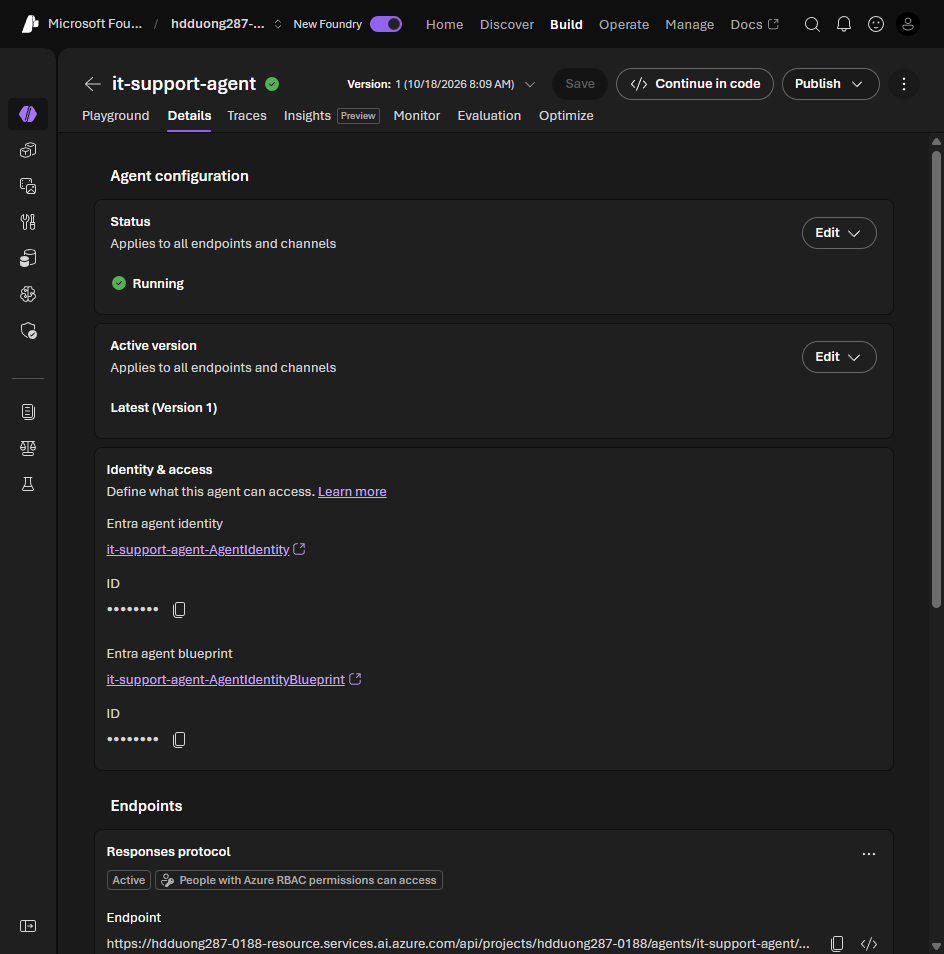

# 08 Test, deploy, and integrate agents

[Test, deploy, and integrate agents](https://learn.microsoft.com/en-us/training/modules/develop-ai-agents-azure-vs-code/8-test-deploy-integrate?pivots=text)

- Playground checks: happy path, edge cases, out-of-scope requests, more than one turn, and that the right tool runs.
- **Save** in the portal, or **Save to Foundry** in VS Code, writes the prompt agent into the project.
- A hosted agent deploys from **+ Build > Deploy to Microsoft Foundry**. **Code (ZIP Code Deploy)** ships source with no image. **Container (BYOI)** uses an image already in Azure Container Registry.
- Creating the agent also creates a stable endpoint, its own Entra identity, and an agent blueprint. Project RBAC does not transfer. A tool that worked in the playground fails after publish until that identity has the role.
- Callers need **Foundry User** on the agent. API keys are not supported. A missing role is **403**.
- The published endpoint is stateless Responses. The client keeps the history. The URL stays the same when you save a new version.
- In VS Code, **View Code** on the agent writes a sample that signs in and calls this endpoint.

## Published endpoint

The agent's **Details** tab shows the Entra agent identity, the blueprint, and the Responses endpoint.



```text
POST https://{resource-name}.services.ai.azure.com/api/projects/<project-name>/agents/healthcare-assistant/endpoint/protocols/openai/responses?api-version=2025-11-15-preview
Authorization: Bearer <token from az account get-access-token --resource https://ai.azure.com>
Content-Type: application/json

{"input":"Say hello"}
```

`model` is not on this call. The agent already has the deployment.

The same call from Python. The token scope is `https://ai.azure.com/.default`, and the caller needs **Foundry User** on the agent.

```python
import requests
from azure.identity import DefaultAzureCredential

token = DefaultAzureCredential().get_token("https://ai.azure.com/.default").token
url = (
    "https://{resource-name}.services.ai.azure.com/api/projects/<project-name>"
    "/agents/it-support-agent/endpoint/protocols/openai/responses"
    "?api-version=2025-11-15-preview"
)
response = requests.post(
    url,
    headers={"Authorization": f"Bearer {token}"},
    json={"input": "Say hello"},
)
print(response.status_code, response.json())
```
