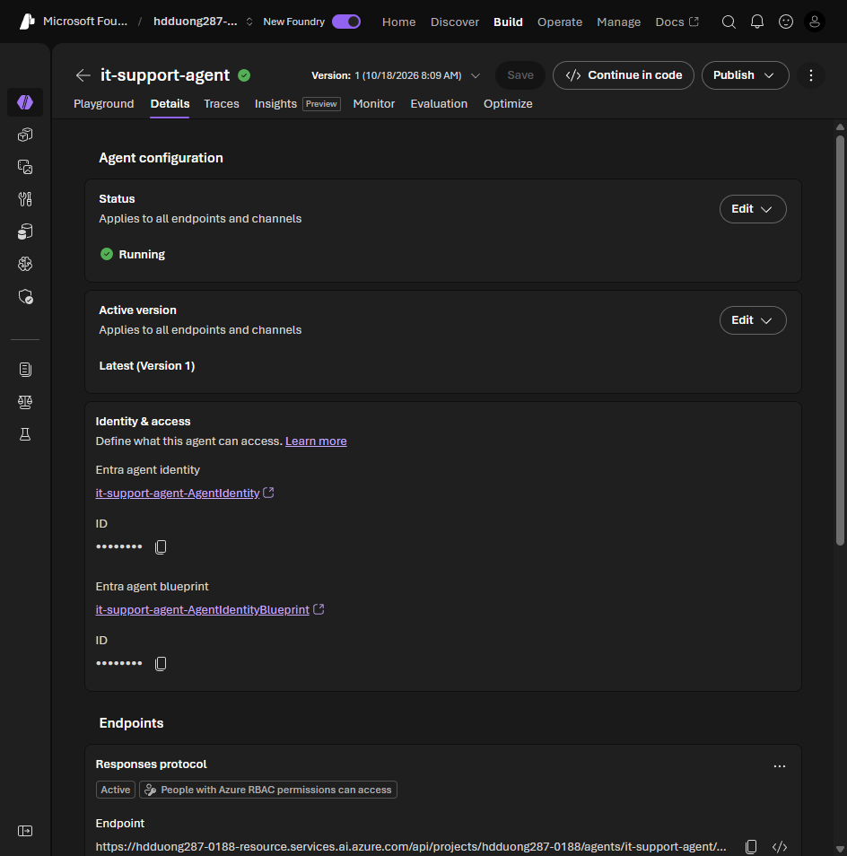

# 08 Test, deploy, and integrate agents

[Test, deploy, and integrate agents](https://learn.microsoft.com/en-us/training/modules/develop-ai-agents-azure-vs-code/8-test-deploy-integrate?pivots=text)

- Playground checks: happy path, edge cases, out-of-scope requests, more than one turn, and that the right tool runs.
- **Save** in the portal, or **Save to Foundry** in VS Code, writes the prompt agent into the project.
- A hosted agent deploys from **+ Build > Deploy to Microsoft Foundry**. **Code (ZIP Code Deploy)** ships source with no image. **Container (BYOI)** uses an image already in Azure Container Registry.
- Creating an agent gives it a stable endpoint, its own Entra identity, and an agent blueprint. Assign the resource roles needed by that agent identity; the project identity's permissions do not automatically transfer.
- The Learn unit uses **Foundry User** for access. Current [agent configuration guidance](https://learn.microsoft.com/en-us/azure/foundry/agents/how-to/configure-agent) also describes **Foundry Agent Consumer** for invocation-only access. Endpoint authentication uses Microsoft Entra ID; an API key is not supported.
- The stable endpoint keeps its URL across agent-version updates. The Learn unit describes stateless invocation; current conversation support depends on the agent type and protocol, so follow the endpoint documentation for multi-turn state.
- In VS Code, **View Code** on the agent writes a sample that signs in and calls this endpoint.

## Lab client: chat with the portal agent

The [portal and VS Code exercise](https://microsoftlearning.github.io/mslearn-ai-agents/Instructions/Exercises/01-build-agent-portal-and-vscode.html) uses a project SDK client to call the saved `it-support-agent`. Complete the [portal configuration](04-build-agent-azure-portal.md#lab-it-support-agent) and [local environment](05-set-up-vs-code.md#prepare-the-python-client) first. The two blocks below form one `agent_client.py`.

### Download the result of Code Interpreter

The model's text is only part of the response. A generated chart can be referenced by a `container_file_citation` annotation, which supplies the container ID, file ID, and suggested filename. Start `agent_client.py` with a helper that retrieves that file:

```python
import os
from pathlib import Path
from uuid import uuid4

from azure.ai.projects import AIProjectClient
from azure.identity import DefaultAzureCredential
from dotenv import load_dotenv


def save_artifacts(client, response, downloaded):
    output_dir = Path("agent_outputs")
    # Only message items carry file citations; skip the others
    for item in response.output:
        if item.type != "message":
            continue
        for content in item.content:
            # Not every content part has annotations; missing means none
            for annotation in getattr(content, "annotations", None) or []:
                # Keep only citations of files in the Code Interpreter container
                if annotation.type != "container_file_citation":
                    continue
                # The same file can be cited more than once; download it once
                key = (annotation.container_id, annotation.file_id)
                if key not in downloaded:
                    output_dir.mkdir(exist_ok=True)
                    # Base name only (or output.bin), so files stay in agent_outputs/
                    filename = Path(annotation.filename or "output.bin").name
                    if filename in {"", ".", ".."}:
                        filename = "output.bin"
                    # Random prefix so a new file doesn't overwrite an earlier one
                    target = output_dir / f"{uuid4().hex[:8]}_{filename}"
                    # Download the file's bytes from the Code Interpreter container
                    data = client.containers.files.content.retrieve(
                        container_id=annotation.container_id,
                        file_id=annotation.file_id,
                    )
                    target.write_bytes(data.read())
                    downloaded[key] = target
                # Print the local path, whether new or saved earlier
                print("Saved artifact:", downloaded[key])
```

This teaching adaptation focuses on Code Interpreter's cited files; the [upstream client](https://github.com/MicrosoftLearning/mslearn-ai-agents/blob/4d6a32629722927bd5f1034e0b5396e0da4e962c/Labfiles/01-build-agent-portal-and-vscode/Python/agent_with_functions.py) also handles additional image output forms and rewrites file citations in the displayed text.

### Preserve the conversation across turns

Append the following block.

```python
def main():
    # Read PROJECT_ENDPOINT and AGENT_NAME from .env
    load_dotenv()
    # Sign in with az login, open the project, get the OpenAI-style client
    with (
        DefaultAzureCredential() as credential,
        AIProjectClient(endpoint=os.environ["PROJECT_ENDPOINT"],
                        credential=credential) as project,
        project.get_openai_client() as client,
    ):
        # Load the portal agent; it holds the model and tool settings
        agent = project.agents.get(agent_name=os.environ["AGENT_NAME"])
        # Empty conversation; it keeps the chat history across turns
        conversation = client.conversations.create(items=[])
        # Cache of files already saved, kept across turns
        downloaded = {}
        try:
            # Chat until you type exit or quit
            while True:
                prompt = input("You (exit to stop): ").strip()
                if prompt.lower() in {"exit", "quit"}:
                    break
                if not prompt:
                    continue
                # Add your message to the conversation first
                client.conversations.items.create(
                    conversation_id=conversation.id,
                    items=[{"type": "message", "role": "user", "content": prompt}],
                )
                # Run the saved agent on the conversation, not a bare model
                response = client.responses.create(
                    conversation=conversation.id,
                    extra_body={"agent_reference": {"name": agent.name, "type": "agent_reference"}},
                    input="",  # empty: the prompt is already in the conversation
                )
                # The run failed on the service side
                if response.status == "failed":
                    raise RuntimeError(str(response.error))
                print("Agent:", response.output_text)
                # Foundry already ran the tools; just download cited files
                save_artifacts(client, response, downloaded)
        finally:
            # Delete this chat even on errors; the portal agent stays
            client.conversations.delete(conversation_id=conversation.id)


if __name__ == "__main__":
    main()
```

```bash
python agent_client.py
```

Ask the [unit 04 test prompts](04-build-agent-azure-portal.md#lab-it-support-agent). Check a policy answer against `IT_Policy.txt`, check calculated numbers against the CSV, and open the printed chart path. Then ask a follow-up such as `Show that as a chart` to confirm that the conversation retains the previous question. A text-only answer is not enough to verify file generation; look for the downloaded artifact.

## Invoke the stable agent endpoint

The agent's **Details** tab shows the Entra agent identity, the blueprint, and the Responses endpoint.



```text
POST https://{resource-name}.services.ai.azure.com/api/projects/<project-name>/agents/it-support-agent/endpoint/protocols/openai/responses?api-version=2025-11-15-preview
Authorization: Bearer <token from az account get-access-token --resource https://ai.azure.com>
Content-Type: application/json

{"input":"Say hello"}
```

`model` is not on this call. The agent already has the deployment.

The same call from Python. The caller needs a role that permits invocation on the agent.

```python
import requests
from azure.identity import DefaultAzureCredential

# Entra ID bearer token for Foundry; this endpoint takes no API keys
token = DefaultAzureCredential().get_token("https://ai.azure.com/.default").token
# Stable Responses endpoint; same URL across agent versions
url = (
    "https://{resource-name}.services.ai.azure.com/api/projects/<project-name>"
    "/agents/it-support-agent/endpoint/protocols/openai/responses"
    "?api-version=2025-11-15-preview"
)
# No model in the body: the agent already has its deployment
response = requests.post(
    url,
    headers={"Authorization": f"Bearer {token}"},
    json={"input": "Say hello"},
    timeout=60,
)
# Raise on any HTTP error, such as a missing role
response.raise_for_status()
print(response.status_code, response.json())
```


This is a single-turn example of the agent endpoint, separate from the exercise's project-SDK route above. The [migration guide](https://learn.microsoft.com/en-us/azure/foundry/agents/how-to/migrate-agent-applications) distinguishes current agent endpoints from legacy Agent Applications. For example, current [hosted-agent Responses sessions](https://learn.microsoft.com/en-us/azure/foundry/agents/how-to/manage-hosted-sessions) support `previous_response_id` or a conversation ID. Use the state mechanism documented for your agent type and protocol; a single-turn sample does not establish that every agent endpoint is stateless.
