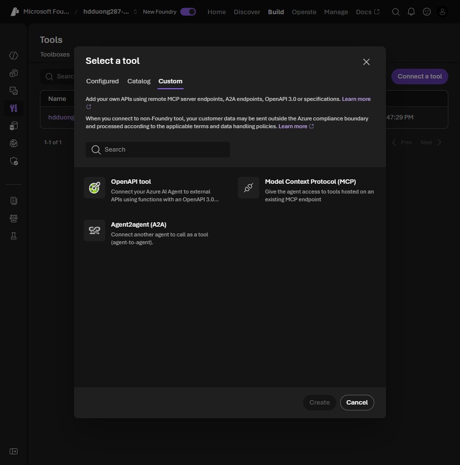

# 03 Options for implementing custom tools

[Options for implementing custom tools](https://learn.microsoft.com/en-us/training/modules/build-agent-with-custom-tools/3-custom-tool-options?pivots=text)

- **Function calling.** You describe the function. The model returns the name and the arguments. Your code runs it. Any language that can host the agent.
- **Azure Functions.** A trigger starts the function. A binding connects the input and the output. The agent sample uses a storage queue in and a storage queue out.
- **OpenAPI 3.0.** The spec is the tool. Foundry calls the HTTP API. Auth is anonymous, API key, or managed identity.
- **Logic Apps.** Low-code workflow that connects apps and data. No SDK sample in this unit.

In the portal, the spec-based tools are under **Tools > Connect a tool > Custom**. A function tool has no portal entry. It lives in your code.



The exercise registers the function as a tool, then puts it on the agent.

```python
event_tool = FunctionTool(
    name="next_visible_event",
    description="Get the next visible event in a given location.",
    parameters={
        "type": "object",
        "properties": {
            "location": {"type": "string", "description": "Continent, such as north_america."},
        },
        "required": ["location"],
        "additionalProperties": False,
    },
    strict=True,
)
print(event_tool.name)
```
