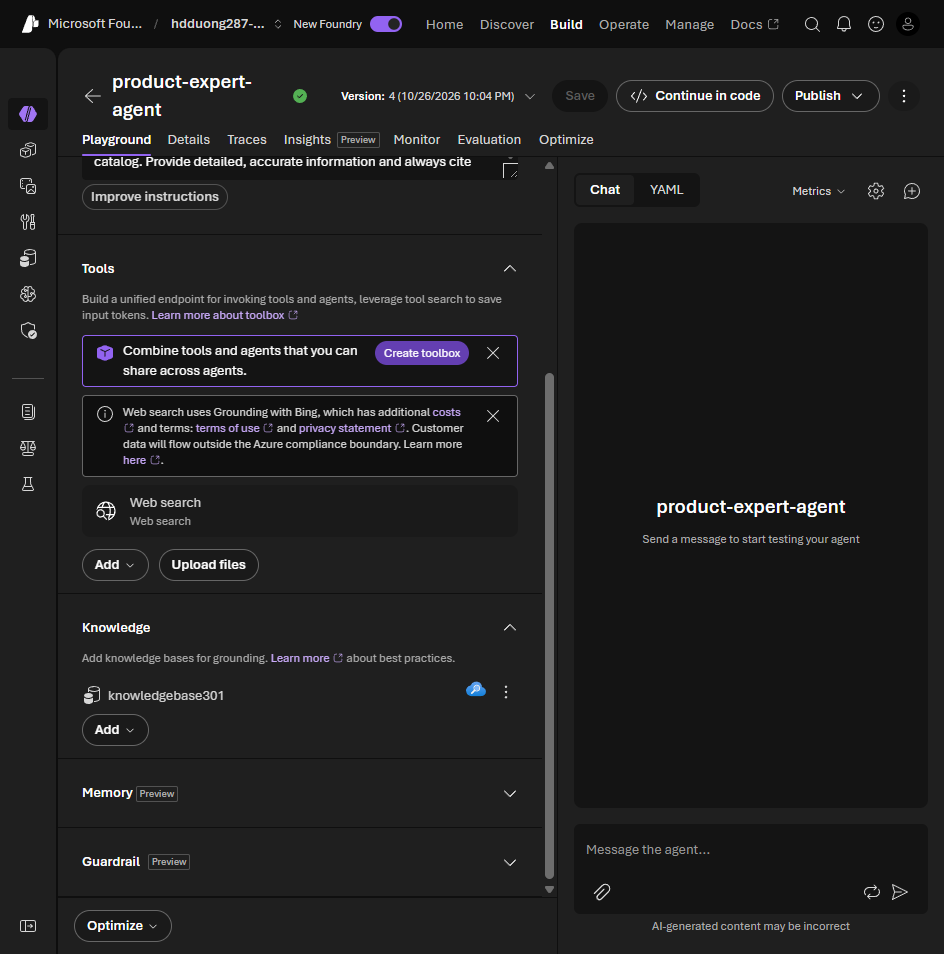

# 02 Understanding RAG for agents

[Understanding RAG for agents](https://learn.microsoft.com/en-us/training/modules/introduction-foundry-iq/2-understand-rag?pivots=text)

- A model with no retrieval misses new facts, private docs, your process, and it will invent an answer. Every team then rebuilds the same search stack.
- RAG is three steps: **retrieve** matching chunks, **augment** the prompt with those chunks, **generate** the reply from that context.
- What you get: answers stay current without a new training run, the reply can name the source, and the answer is tied to your documents.
- Foundry IQ is that stack as a shared service. The next unit is the product.

In the exercise, `product-expert-agent` gets its retrieve step from `knowledgebase301` under **Knowledge**.

The lab's portal setup is in [04](04-data-requirements.md#lab-blob-source-for-product-expert-agent). Its Python client, which calls the agent and answers the knowledge-base approval requests, is in [05](05-configure-retrieval.md#lab-ask-then-approve-the-knowledge-base-call).
