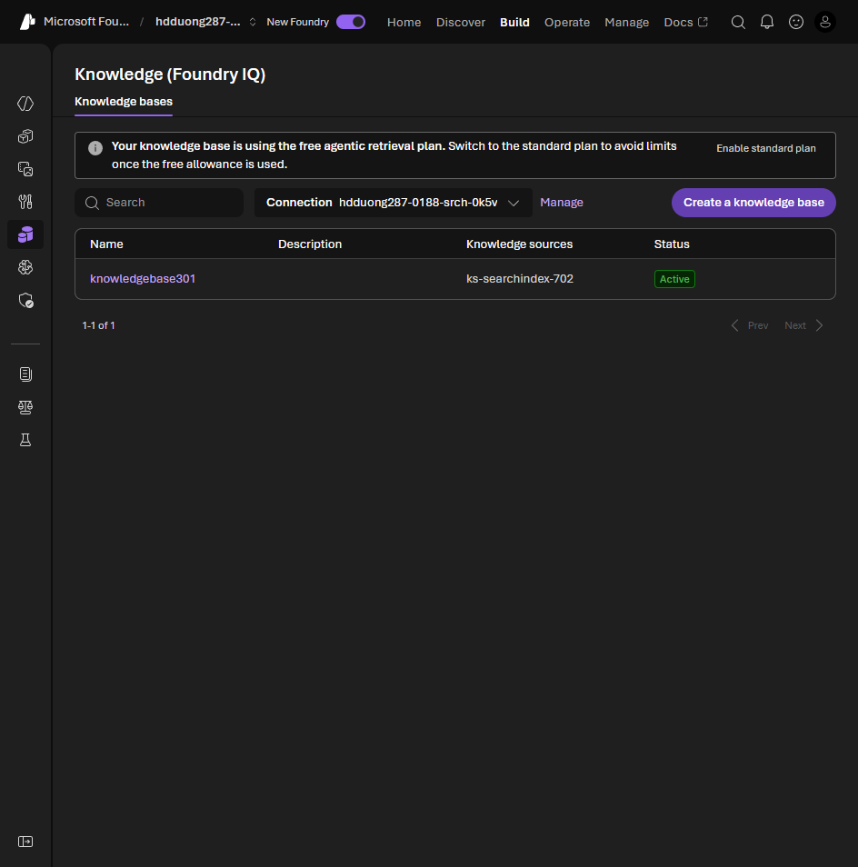

# 03 Explore Foundry IQ

[Explore Foundry IQ](https://learn.microsoft.com/en-us/training/modules/introduction-foundry-iq/3-foundry-iq?pivots=text)

- Foundry IQ is a managed knowledge layer on Azure AI Search. Many agents share one knowledge base. You do not stand up a vector database per agent.
- A knowledge base is a business domain, such as "Product Documentation", not a container name. SharePoint, Blob, and OneLake can sit in the same base.
- Adding a source: discover files, chunk and embed them, index them, reindex when they change.
- The service picks the search (keyword, semantic, query expansion), ranks the hits, and returns citations. You do not write that retrieval code.
- The connection is MCP. The URL is `{search_endpoint}/knowledgebases/{name}/mcp`.



## Knowledge base as an MCP tool

In the lab the portal adds this tool when you connect the knowledge base, and the connection stores the Search key. The same thing in code:

```python
from azure.ai.projects.models import MCPTool, PromptAgentDefinition

knowledge_tool = MCPTool(
    server_label="product-docs",
    server_url=f"{search_endpoint}/knowledgebases/product-documentation/mcp",
    require_approval="always",
)
agent = project_client.agents.create_version(
    agent_name="product-support-agent",
    definition=PromptAgentDefinition(
        model="gpt-4.1",  # deployment name
        instructions="Answer product questions from the knowledge base. Always cite the source.",
        tools=[knowledge_tool],
    ),
)
print(agent.name)
```
