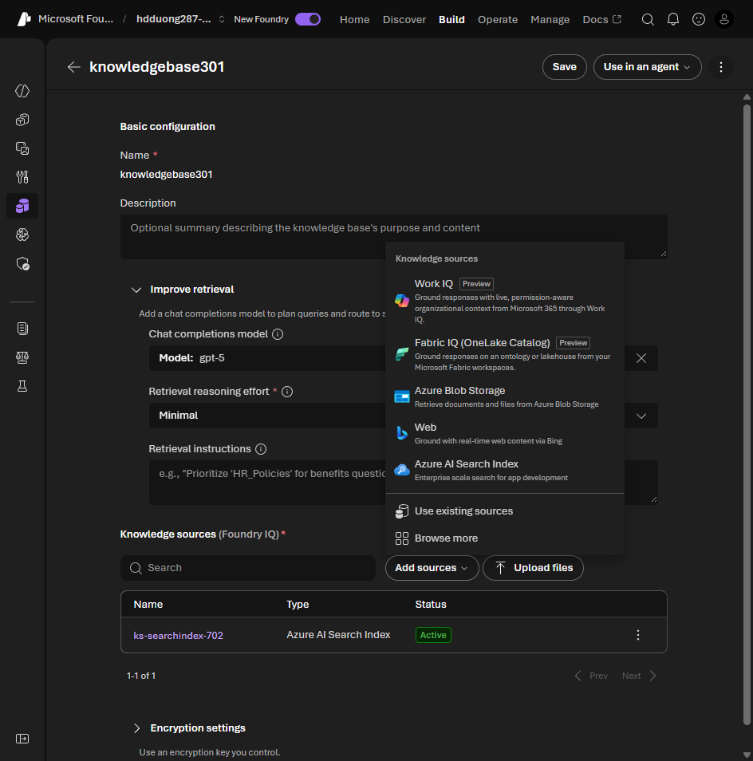

# 04 Configure data sources for knowledge bases

[Configure data sources for knowledge bases](https://learn.microsoft.com/en-us/training/modules/introduction-foundry-iq/4-data-requirements?pivots=text)

The Learn unit groups sources as follows. A knowledge base can combine supported sources. “Direct” describes selecting the original files rather than supplying an existing Search index; it does not mean Blob retrieval bypasses indexing.

| Source | Access | Pick it when |
| --- | --- | --- |
| Azure AI Search index | Indexed | Reuse an existing searchable index, semantic configuration, and supported filters |
| Azure Blob Storage | Direct, with managed ingestion | Files in a container; Foundry IQ provisions supporting Search indexing resources |
| Web (Bing) | Real time | Public, changing facts. You do not control the sites |
| SharePoint remote | Real time | Live SharePoint, current permissions, no index |
| SharePoint indexed | Indexed | SharePoint plus custom analyzers, enrichment, or a mix with other sources |
| OneLake | Direct source connection | Unstructured files in a Fabric lakehouse, with the connector's ingestion requirements |

- For the exam, distinguish live SharePoint queries from preprocessed indexed content. Remote results depend on SharePoint's search and permissions; indexed results depend on ingestion freshness. Measure latency for your workload.
- Use web as a backup when the internal base has no answer. Do not use it when the source of the answer has to be yours.

**Add sources** on a knowledge base picks the source type. This project's menu shows Work IQ, Fabric IQ (OneLake), Blob, Web, and Azure AI Search Index, plus **Browse more**.



## Lab: Blob source for product-expert-agent

Lab: [Integrate an AI agent with Foundry IQ](https://microsoftlearning.github.io/mslearn-ai-agents/Instructions/Exercises/04-integrate-agent-with-foundry-iq.html). Portal steps:

1. Create `product-expert-agent`. Under **Knowledge > Add > Connect to Foundry IQ**, create or pick an Azure AI Search resource in the same resource group and region (Free if offered, else Basic).
2. Create a Storage account (Standard, LRS) and a container `contosoproducts`. Upload the three PDFs from the lab's [contoso-products.zip](https://github.com/MicrosoftLearning/mslearn-ai-agents/raw/4d6a32629722927bd5f1034e0b5396e0da4e962c/Labfiles/04-integrate-agent-with-foundry-iq/data/contoso-products.zip).
3. On the Search resource, **Keys > API Access control > Both**, so the lab's key connection works.
4. Back in **Knowledge**, create a knowledge base and add the Blob source with the settings below. Save, refresh, and wait until the source is active.
5. Next to the Search connection, select **Manage**, open its **Connected resources** entry, choose **Key authentication > Edit authentication**, and save the Search key. Enabling keys on Search in step 3 does not populate the Foundry connection.
6. Return to `product-expert-agent`, select **Knowledge > Add > Foundry IQ**, and attach that connection and knowledge base. Test a product question in the playground before writing the client.

```text
Name: ks-contosoproducts
Description: Contoso product catalog items
Source: Azure Blob Storage
Container: contosoproducts
Authentication: API key
Content extraction mode: minimal
Embedding model: text-embedding-3-small
Chat completions model: gpt-5
```

The [Blob knowledge-source reference](https://learn.microsoft.com/en-us/azure/search/agentic-knowledge-source-how-to-blob) lists the generated index, data source, skillset, and indexer. Selecting the container provides the documents; the embedding model makes their chunks searchable, while the knowledge base's chat model supports the configured retrieval behavior.

Test `What types of tents does Contoso offer?` and inspect which PDF supplied the answer. If the source is inactive, fix ingestion; if retrieval fails authorization, check the Search connection from step 5. These are separate from the Python client's Foundry login in [unit 05](05-configure-retrieval.md#lab-ask-then-approve-the-knowledge-base-call).

An existing Search index can have scoring profiles, but [agentic retrieval does not apply them to result ranking](https://learn.microsoft.com/en-us/azure/search/agentic-retrieval-how-to-retrieve#limitations). Do not assume every ordinary Search query option carries over to a knowledge-base query.
