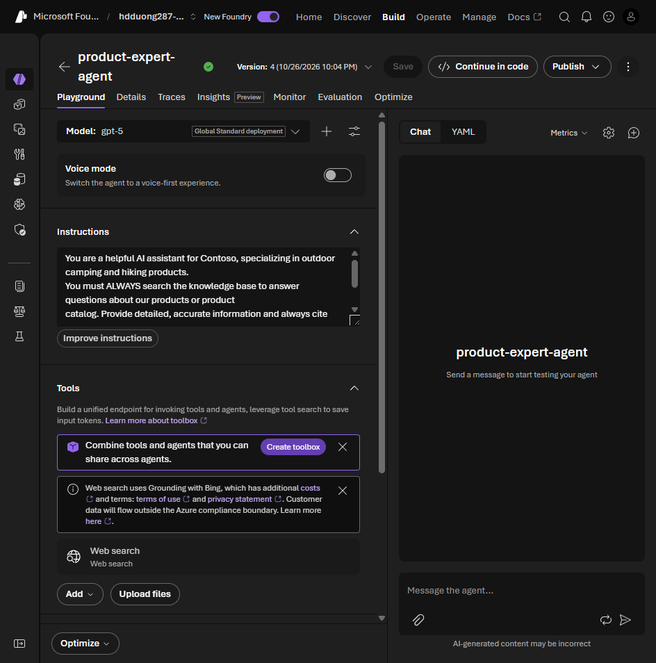
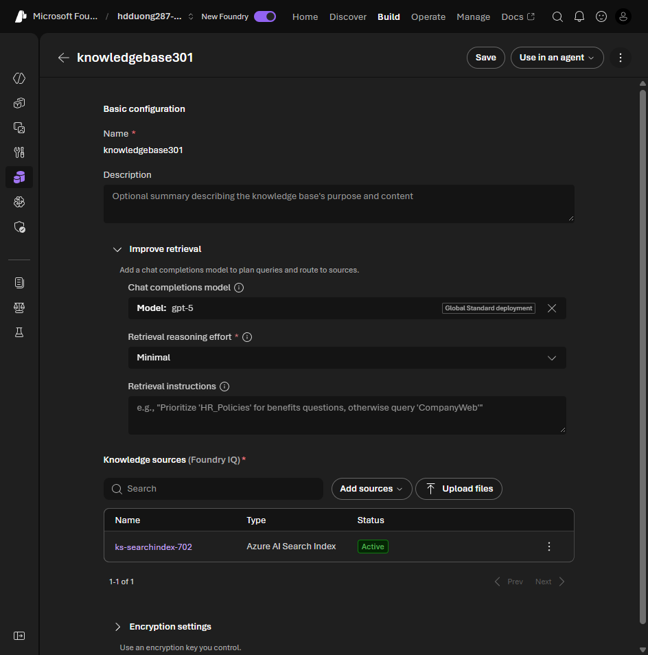

# 05 Configure retrieval with Foundry IQ

[Configure retrieval with Foundry IQ](https://learn.microsoft.com/en-us/training/modules/introduction-foundry-iq/5-configure-retrieval?pivots=text)

- A vague instruction ("use the knowledge base") lets the model answer from training data or skip the citation.
- Say three things: always search first, the citation format, and what to say when the base has no answer.
- Test four prompts: a fact, a question that needs several documents, a question outside the base, and an ambiguous one.
- A good reply is grounded, cited, relevant, and complete.
- Support agents should refuse to guess. Research agents may combine sources and should cite all of them. Compliance agents stay inside the policy text and name the section and effective date.
- In production, watch citation rate, how often it says it does not know, and whether the retrieved docs actually answer the question.
- The Learn unit puts the reference under `extra_body["agent"]`. The lab uses `extra_body["agent_reference"]` with `type` `agent_reference`. Either way the call runs the saved agent, so there is no `model` argument.

## Instructions from the exercise

The lab sets these instructions on the agent, then adds Foundry IQ under Knowledge. The client does not pass `model`. It passes `agent_reference`.



The knowledge base has its own retrieval settings: the chat model that plans queries, **Retrieval reasoning effort**, and **Retrieval instructions** that say which source to try first.



```python
instructions = """
You are a helpful AI assistant for Contoso, specializing in outdoor camping and hiking products.
You must ALWAYS search the knowledge base to answer questions about our products or product catalog.
Provide detailed, accurate information and always cite your sources.
If you don't find relevant information in the knowledge base, say so clearly.
"""
print(instructions)
```

## Lab: ask, then approve the knowledge-base call

From the [Foundry IQ lab](https://microsoftlearning.github.io/mslearn-ai-agents/Instructions/Exercises/04-integrate-agent-with-foundry-iq.html). Set the instructions above on `product-expert-agent` first. The portal connection may auto-approve, so in VS Code open the agent, find the tool named `kb-knowledgebase...`, **Configure > Never auto-approve tools**, and save.

```bash
pip install "azure-ai-projects==2.3.0" "openai<3" azure-identity python-dotenv
az login
```

`.env`:

```dotenv
PROJECT_ENDPOINT=https://{resource-name}.services.ai.azure.com/api/projects/<project-name>
AGENT_NAME=product-expert-agent
```

```python
import os
from azure.ai.projects import AIProjectClient
from azure.identity import DefaultAzureCredential
from dotenv import load_dotenv

load_dotenv()
credential = DefaultAzureCredential(
    exclude_environment_credential=True,
    exclude_managed_identity_credential=True,
)
project_client = AIProjectClient(
    endpoint=os.environ["PROJECT_ENDPOINT"],
    credential=credential,
)
openai_client = project_client.get_openai_client()
agent = project_client.agents.get(agent_name=os.environ["AGENT_NAME"])
reference = {"agent_reference": {"name": agent.name, "type": "agent_reference"}}
conversation = openai_client.conversations.create(items=[])

while True:
    question = input("You (exit to stop): ").strip()
    if question.lower() in {"exit", "quit"}:
        break
    openai_client.conversations.items.create(
        conversation_id=conversation.id,
        items=[{"type": "message", "role": "user", "content": question}],
    )
    response = openai_client.responses.create(
        conversation=conversation.id,
        extra_body=reference,
        input="",
    )
    while True:
        approval_requests = [item for item in response.output if item.type == "mcp_approval_request"]
        if not approval_requests:
            break
        decisions = []
        for request in approval_requests:
            print(f"Tool: {request.name}  Arguments: {request.arguments}")
            decisions.append({
                "type": "mcp_approval_response",
                "approval_request_id": request.id,
                "approve": input("Approve? [y/N] ").lower() == "y",
            })
        openai_client.conversations.items.create(
            conversation_id=conversation.id,
            items=decisions,
        )
        response = openai_client.responses.create(
            conversation=conversation.id,
            extra_body=reference,
            input="",
        )
    print("Agent:", response.output_text)

openai_client.conversations.delete(conversation_id=conversation.id)
```

- The approvals go onto the conversation as items, then `responses.create` runs again with `input=""`.
- The lab approves every request automatically. Asking with `input()` is the human version.
- The Search key lives in the portal connection, so this client has no Search credentials.

| Ask | Expect |
| --- | --- |
| `What tents does Contoso sell?` | A knowledge-base call, product facts, and citations to the PDFs |
| `Which extra-large backpacks are available?` | Catalog details, not a generic camping answer |
| `Compare a tent and a backpack for a multi-day hike. Include useful accessories.` | Facts from more than one document |
| `Does Contoso sell smartphones?` | A clear "not in the knowledge base" |
| Deny the approval | An answer that says it could not search, with no invented products |
