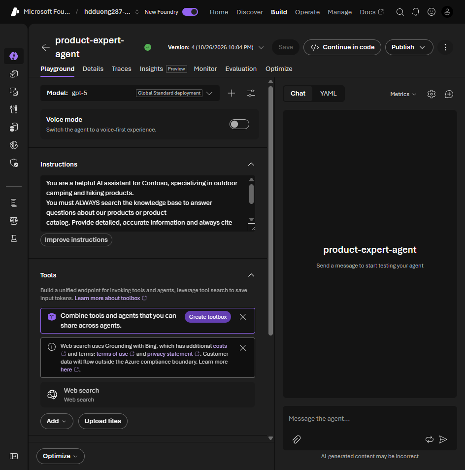
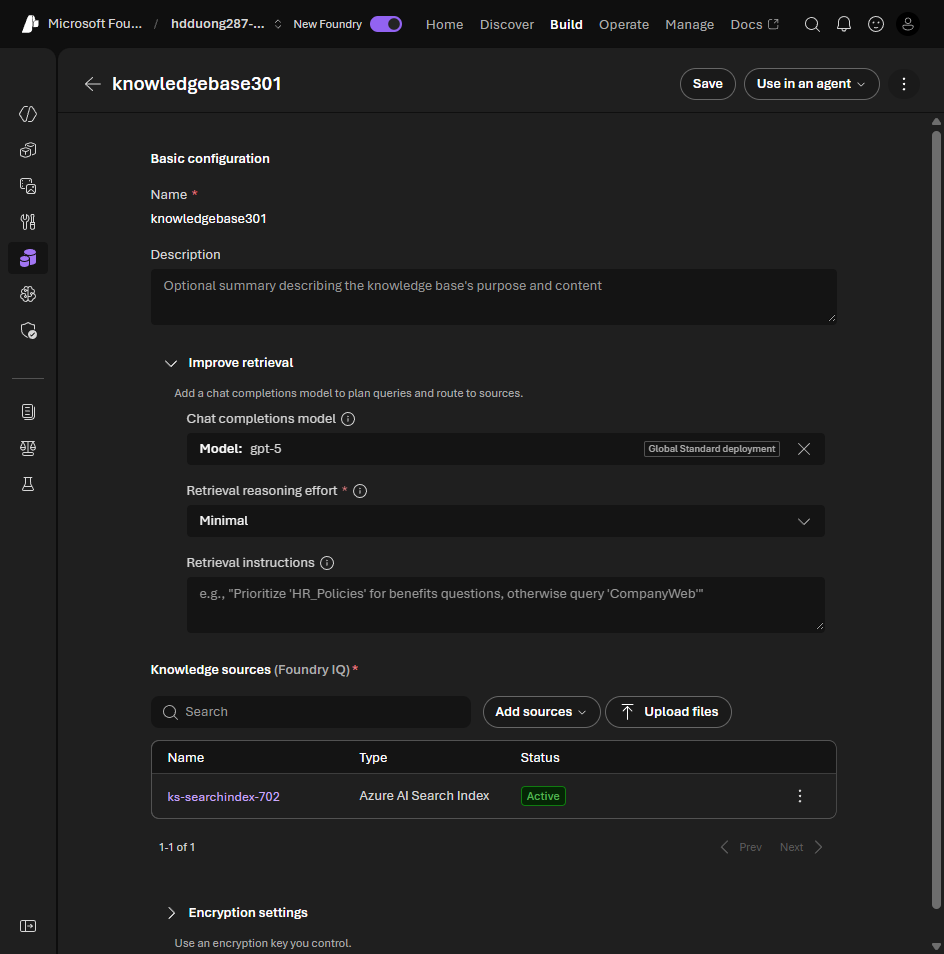

# 05 Configure retrieval with Foundry IQ

[Configure retrieval with Foundry IQ](https://learn.microsoft.com/en-us/training/modules/introduction-foundry-iq/5-configure-retrieval?pivots=text)

- A vague instruction ("use the knowledge base") lets the model answer from training data or skip the citation.
- Say three things: always search first, the citation format, and what to say when the base has no answer.
- Test four prompts: a fact, a question that needs several documents, a question outside the base, and an ambiguous one.
- A good reply is grounded, cited, relevant, and complete.
- Support agents should refuse to guess. Research agents may combine sources and should cite all of them. Compliance agents stay inside the policy text and name the section and effective date.
- In production, watch citation rate, how often it says it does not know, and whether the retrieved docs actually answer the question.
- The Learn unit shows `extra_body["agent"]`; the exercise and code here use `extra_body["agent_reference"]` with `type="agent_reference"`. Follow the exercise syntax consistently. The saved agent already defines its model, so this call has no `model` argument.

## Instructions from the exercise

The lab sets these instructions on the agent, then adds Foundry IQ under Knowledge. The client does not pass `model`. It passes `agent_reference`.



The knowledge base has its own retrieval settings: the chat model that plans queries, **Retrieval reasoning effort**, and **Retrieval instructions** that say which source to try first.



```text
You are a helpful AI assistant for Contoso, specializing in outdoor camping and hiking products.
You must ALWAYS search the knowledge base to answer questions about our products or product catalog.
Provide detailed, accurate information and always cite your sources.
If you don't find relevant information in the knowledge base, say so clearly.
```

## Lab: ask, then approve the knowledge-base call

From the [Foundry IQ lab](https://microsoftlearning.github.io/mslearn-ai-agents/Instructions/Exercises/04-integrate-agent-with-foundry-iq.html). Set the instructions above on `product-expert-agent` first. The portal connection may auto-approve, so in VS Code open the agent, find the tool named `kb-knowledgebase...`, **Configure > Never auto-approve tools**, and save.

Use Python 3.13 as specified by the exercise, and create a working directory for the client:

```bash
# Create a virtual environment for the lab
python -m venv .venv
# macOS/Linux
source .venv/bin/activate
# Windows PowerShell instead: .venv\Scripts\Activate.ps1
# Install the lab packages
python -m pip install "azure-ai-projects==2.3.0" "openai<3" azure-identity python-dotenv
# Sign in so DefaultAzureCredential can use your account
az login
```

`.env`:

```dotenv
# Project endpoint from the Foundry project home page
PROJECT_ENDPOINT=https://{resource-name}.services.ai.azure.com/api/projects/<project-name>
# Name of the agent you set up in the portal
AGENT_NAME=product-expert-agent
```

### Resume the agent after a decision

Save the next two Python blocks together as `agent_client.py`. The first block implements one question and its possible approval rounds.

```python
import os
from azure.ai.projects import AIProjectClient
from azure.identity import DefaultAzureCredential
from dotenv import load_dotenv


def answer_question(client, conversation_id, reference, question):
    # Add the question to the conversation as a user message
    client.conversations.items.create(
        conversation_id=conversation_id,
        items=[{"type": "message", "role": "user", "content": question}],
    )
    # Keep answering approval requests until the final answer comes back
    for round_number in range(9):
        # Run the agent; input stays empty, the conversation already has it
        response = client.responses.create(
            conversation=conversation_id, extra_body=reference, input="",
        )
        # The run failed on the service side
        if response.status == "failed":
            raise RuntimeError(str(response.error))
        # Knowledge-base lookups the agent wants to make, waiting for a yes/no
        requests = [item for item in response.output if item.type == "mcp_approval_request"]
        # Nothing waiting: this response is the answer
        if not requests:
            return response.output_text
        # Safety stop so a chatty agent can't loop forever
        if round_number == 8:
            raise RuntimeError("Stopped after eight knowledge-base approval rounds.")
        decisions = []
        for request in requests:
            # Show which tool it wants to call, and with what arguments
            print(f"Server: {request.server_label}  Tool: {request.name}")
            print("Arguments:", request.arguments)
            # Each decision points back at its request by id
            decisions.append({
                "type": "mcp_approval_response",
                "approval_request_id": request.id,
                "approve": input("Approve? [y/N] ").strip().lower() == "y",  # yes only if you type y
            })
        # Add the decisions to the conversation; the next round resumes
        client.conversations.items.create(
            conversation_id=conversation_id, items=decisions,
        )
    raise RuntimeError("Stopped after eight knowledge-base approval rounds.")
```

The exercise approves automatically; the prompt above is an adaptation that lets you inspect and deny the requested operation.

### Connect the client to the saved portal agent

Append this block to `agent_client.py`:

```python
def main():
    # Read PROJECT_ENDPOINT and AGENT_NAME from .env
    load_dotenv()
    # Sign in with az login, open the project, get the OpenAI-style client
    with (
        DefaultAzureCredential(
            exclude_environment_credential=True,  # env-var credentials can't replace az login
            exclude_managed_identity_credential=True,  # nor can a managed identity
        ) as credential,
        AIProjectClient(endpoint=os.environ["PROJECT_ENDPOINT"],
                        credential=credential) as project,
        project.get_openai_client() as client,
    ):
        # Load the saved portal agent by name; nothing is created here
        agent = project.agents.get(agent_name=os.environ["AGENT_NAME"])
        # Run the saved agent by name, without pinning a version
        reference = {"agent_reference": {"name": agent.name, "type": "agent_reference"}}
        # One conversation keeps context across the whole chat
        conversation = client.conversations.create(items=[])
        try:
            # Chat loop: one question at a time until you type exit
            while True:
                question = input("You (exit to stop): ").strip()
                if question.lower() in {"exit", "quit"}:
                    break
                if question:
                    # Ask, handle any approval rounds, print the final answer
                    print("Agent:", answer_question(client, conversation.id, reference, question))
        finally:
            # Delete this run's conversation; the portal agent stays
            client.conversations.delete(conversation_id=conversation.id)


if __name__ == "__main__":
    main()
```

The client authenticates to Foundry; Search authentication remains in the project connection configured in [unit 04](04-data-requirements.md#lab-blob-source-for-product-expert-agent).

```bash
python agent_client.py
```

### Check grounding, citations, and refusal

| Ask | Expect |
| --- | --- |
| `What tents does Contoso sell?` | A knowledge-base call, product facts, and citations to the PDFs |
| `Which extra-large backpacks are available?` | Catalog details, not a generic camping answer |
| `Compare a tent and a backpack for a multi-day hike. Include useful accessories.` | Facts from more than one document |
| `Does Contoso sell smartphones?` | A clear "not in the knowledge base" |
| Deny the approval | An answer that says it could not search, with no invented products |
