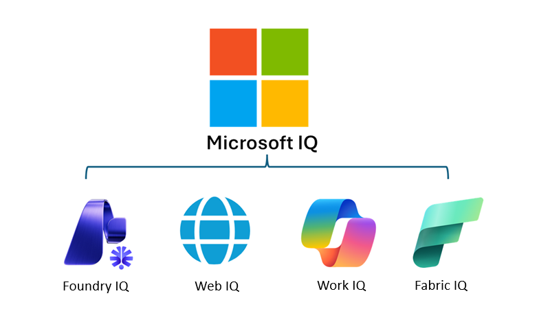

# 01 Introduction

[Introduction](https://learn.microsoft.com/en-us/training/modules/get-started-web-iq/1-introduction?pivots=text)

- A model only knows what it saw before its training cutoff. "Are they playing any gigs soon?" needs current evidence, and an answer from old data can sound right and still be wrong.
- **Web IQ** is a set of AI-native web search and grounding APIs. It returns ranked, citation-ready context from web pages, news, images, and videos.
- That is RAG: retrieve at run time, add the results to the context, then generate. No retraining when the world changes.
- This module: Web IQ's methods, setting up a Web IQ resource, connecting it to a Foundry agent over MCP, and checking that the answer matches the evidence.

## Microsoft IQ

Web IQ is one part of **Microsoft IQ**, the family of knowledge services for grounding agents. Pick the one that matches the question.

Diagram from [Microsoft Learn](https://learn.microsoft.com/en-us/training/modules/get-started-web-iq/1-introduction?pivots=text) (CC BY 4.0).

| Service | Grounds the agent in | In these notes |
| --- | --- | --- |
| **Foundry IQ** | Enterprise and web sources, organized into reusable knowledge bases | [Module 004](../004-introduction-foundry-iq/README.md) |
| **Web IQ** | The current public web: pages, news, images, videos | This module |
| **Work IQ** | Microsoft 365 work context: documents, communications, people | [006/05](../006-integrate-foundry-agent-with-m365/05-access-m365-data-workiq.md) |
| **Fabric IQ** | Business meaning over organizational data in Microsoft Fabric | A knowledge source option in [004/04](../004-introduction-foundry-iq/04-data-requirements.md) |

What an agent can actually read still depends on each service's permissions and setup.
