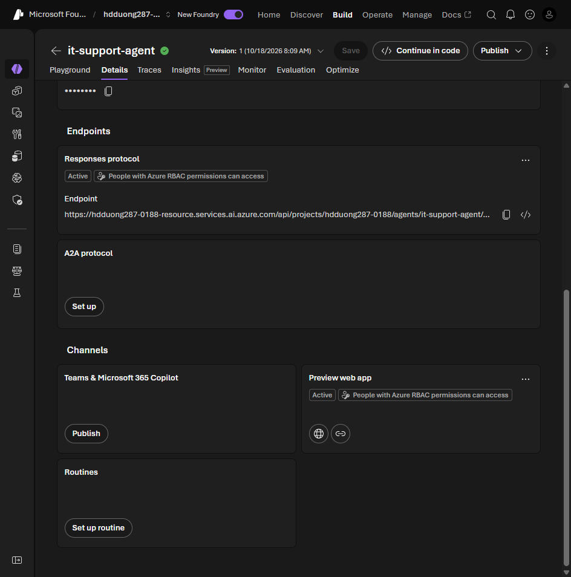

# 02 Understand Foundry agent publishing options

[Understand Foundry agent publishing options](https://learn.microsoft.com/en-us/training/modules/integrate-foundry-agent-with-m365/2-understand-publishing-options?pivots=text)

- Publish turns the agent into an **Agent Application**: a stable URL, its own Entra identity, and user data that stays per user. A new version does not change the URL.
- Microsoft 365 publish creates an Azure Bot Service resource, an Entra app registration, and a package for the Teams store.
- Direct publish from the portal is the normal path. The Agents Toolkit proxy is for custom SSO, middleware, or a dev/stage/prod pipeline.
- **Shared** scope shows under **Your agents** with no admin approval. **Organization** scope shows under **Built by your org** and needs admin approval.
- Other channels: a web preview, the stable Responses endpoint, and Bot Service channels (Slack, Telegram, Twilio SMS, Facebook).
- The published identity is not the project identity. Re-grant roles for Azure AI Search and any other tool resource.
- Roles: **Azure AI Project Manager** to publish, **Azure AI User** to chat. You also need rights to create a Bot Service resource and to register an Entra app. A Microsoft 365 tenant that allows custom apps. A **Microsoft Agent 365** license covers discovery and Defender posture.

The agent's **Details** tab lists the endpoints and channels. Teams and Microsoft 365 Copilot is a separate **Publish**. The preview web app is already on.



The Teams exercise sets these instructions before publish:

```text
You are an Enterprise Knowledge Assistant for Contoso Corporation.
Answer questions about company policies from the uploaded documents.
If you don't know, say so.
Always cite the policy.
```
