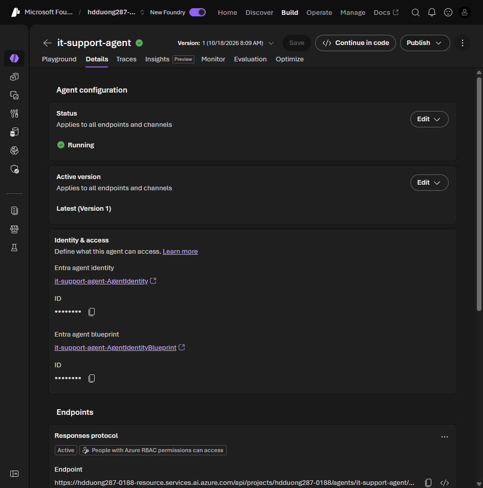

# 03 Publish an agent from Foundry portal to Teams

[Publish an agent from Foundry portal to Teams](https://learn.microsoft.com/en-us/training/modules/integrate-foundry-agent-with-m365/3-publish-agent-foundry-portal?pivots=text)

- Test in the playground first. Confirm **Azure AI Project Manager** on the project and **Azure AI User** on the agent application. Register the **Microsoft.BotService** resource provider.
- Metadata: display name, description, PNG icons at **32×32** and **192×192**, publisher name and contact, privacy policy URL, terms of use URL. Do not put a key in any of those fields.
- Portal path: open the agent, **Publish**, **Publish** again, **Publish to Teams and Microsoft 365 Copilot**. Create the Bot Service in the dialog. **Prepare Agent**. Download the zip, or stay in the portal flow.
- Test a downloaded zip: Teams, **Apps > Manage your apps > Upload an app > Upload a custom app**.
- Organization scope: Microsoft 365 admin center, **Agents > All > Requested**, **Approve request and activate**. It then appears under **Built by your org**. App policies still decide who can open it.
- After publish, copy the new agent identity and grant it RBAC on every Azure resource a tool uses. Then republish to push a change. Organization scope may need approval again.

The identity to grant roles to is on the agent's **Details** tab, under **Identity & access**.



The exercise checks the published agent in Teams with:

```text
Hello! What can you help me with?
What are the laptop password requirements?
What MFA methods are supported?
```
