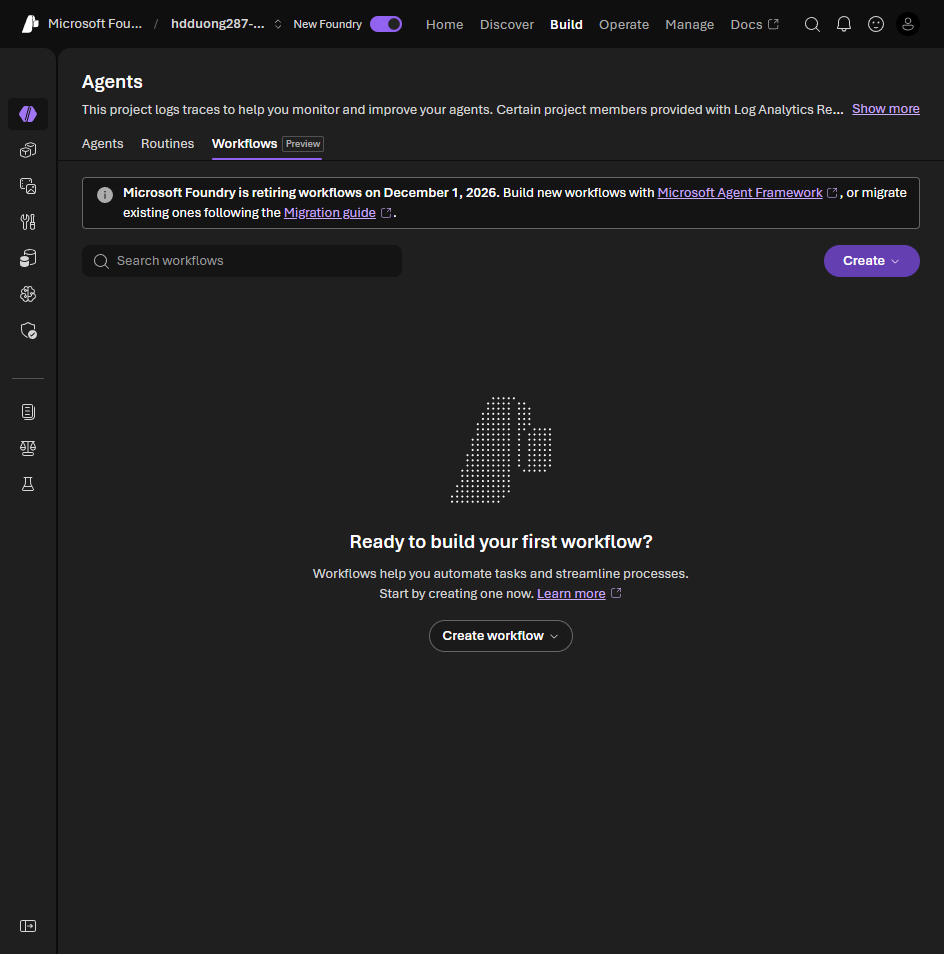

# 02 Understand Workflows

[Understand Workflows](https://learn.microsoft.com/en-us/training/modules/build-agent-workflows-microsoft-foundry/2-understand-workflows?pivots=text)

- A Foundry workflow is a graph of nodes. You draw it. The service runs it and keeps the state. This is the declarative workflow agent, not the Agent Framework SDK in modules 007 and 008.
- A node invokes an agent, checks a condition, sets a variable, or talks to the user.
- Use it when one agent is not enough: classify, decide, then resolve, and pause for a person when confidence is low.

Workflows currently live on **Build > Agents > Workflows**. The [current migration guide](https://learn.microsoft.com/en-us/azure/foundry/agents/concepts/workflow#migration-guide) says the **visual designer and in-portal execution** are unsupported after **December 1, 2026**. Export existing workflow YAML before then. YAML definitions can continue to run when deployed as hosted agents; Microsoft Agent Framework supports the recommended YAML or code migration path, and Azure Logic Apps is a visual alternative. This does not retire every workflow definition or every Agent Framework workflow.

