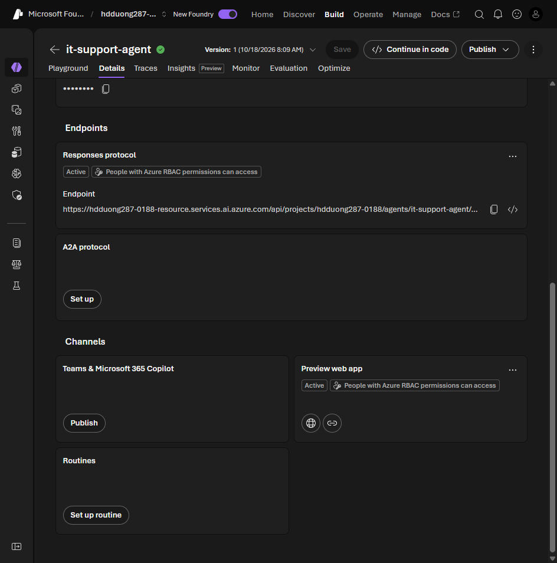

# 02 Understand Foundry agent publishing options

[Understand Foundry agent publishing options](https://learn.microsoft.com/en-us/training/modules/integrate-foundry-agent-with-m365/2-understand-publishing-options?pivots=text)

- The Learn unit describes the **Agent Application** publishing model: a stable invocation URL, a separate Entra identity, and user isolation. In the [new agent model](https://learn.microsoft.com/en-us/azure/foundry/agents/how-to/migrate-agent-applications), an agent already has a stable endpoint and identity. Publishing configures distribution to channels such as Teams and Copilot; it is not required to obtain that endpoint.
- Microsoft 365 publish creates an Azure Bot Service resource, an Entra app registration, and a package for the Teams store.
- Direct publish from the portal is the normal path. The Agents Toolkit proxy is for custom SSO, middleware, or a dev/stage/prod pipeline.
- **Shared** scope shows under **Your agents** with no admin approval. **Organization** scope shows under **Built by your org** and needs admin approval.
- Other channels: a web preview, the stable Responses endpoint, and Bot Service channels (Slack, Telegram, Twilio SMS, Facebook).
- The agent's runtime identity is distinct from the project identity. Grant it the required roles on Azure AI Search and other resources used by its tools; do not assume the project's permissions transfer.
- Learn calls the roles **Azure AI Project Manager** and **Azure AI User**. Their current names are **Foundry Project Manager** and **Foundry User**, with the same role IDs. The new endpoint model also has **Foundry Agent Consumer** for invoke-only access; see [endpoint authorization](https://learn.microsoft.com/en-us/azure/foundry/agents/how-to/configure-agent). Publishing also needs rights to create Bot Service resources and register Entra apps, plus a tenant that allows custom apps. A **Microsoft Agent 365** license covers the discovery and Defender features described in Learn.

The agent's **Details** tab lists the endpoints and channels. Teams and Microsoft 365 Copilot is a separate **Publish** action. In the screenshot, the preview web app is already active.

The lab agent, its instructions, and the publish steps are in [03](03-publish-agent-foundry-portal.md#lab-publish-enterprise-knowledge-agent).
