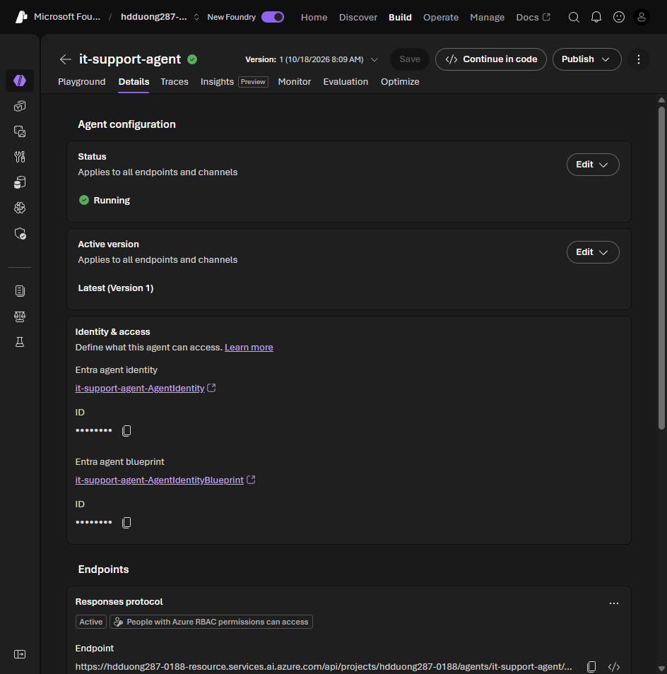

# 03 Publish an agent from Foundry portal to Teams

[Publish an agent from Foundry portal to Teams](https://learn.microsoft.com/en-us/training/modules/integrate-foundry-agent-with-m365/3-publish-agent-foundry-portal?pivots=text)

- Test in the playground first. Confirm **Azure AI Project Manager** on the project and **Azure AI User** on the agent application. Register the **Microsoft.BotService** resource provider.
- Metadata: display name, description, PNG icons at **32×32** and **192×192**, publisher name and contact, privacy policy URL, terms of use URL. Do not put a key in any of those fields.
- Portal path: open the agent, **Publish**, **Publish** again, **Publish to Teams and Microsoft 365 Copilot**. Create the Bot Service in the dialog. **Prepare Agent**. Download the zip, or stay in the portal flow.
- Test a downloaded zip: Teams, **Apps > Manage your apps > Upload an app > Upload a custom app**.
- Organization scope: Microsoft 365 admin center, **Agents > All > Requested**, **Approve request and activate**. It then appears under **Built by your org**. App policies still decide who can open it.
- After publish, copy the new agent identity and grant it RBAC on every Azure resource a tool uses. Then republish to push a change. Organization scope may need approval again.

The identity to grant roles to is on the agent's **Details** tab, under **Identity & access**.



## Lab: publish enterprise-knowledge-agent

Lab: [Publish an agent to Teams and Microsoft 365 Copilot](https://microsoftlearning.github.io/mslearn-ai-agents/Instructions/Exercises/05a-m365-teams-integration.html). Portal only. Teams works with a normal Microsoft 365 account. Copilot needs a Copilot license.

1. Create `enterprise-knowledge-agent`. **Upload files**: the lab's `it_security_policy.txt` and `remote_work_policy.txt`. Set the instructions:

```text
You are an Enterprise Knowledge Assistant for Contoso Corporation.
Answer questions about company policies and procedures using the uploaded documents.
Be professional, helpful, and concise.
Always cite your sources when referencing specific policies.
If the documents don't answer the question, say so and suggest who to contact.
```

2. Test in the playground and save.
3. **Publish > Publish to Teams and Microsoft 365 Copilot**. Fill in the metadata, a 192×192 color icon, and a 32×32 transparent outline icon. App scope **Personal**.
4. **Prepare Agent**, then pick the distribution: **Individual / Shared** shows under **Your agents**; **Organization** shows under **Built by your org** after admin approval.
5. If the direct flow fails and custom apps are allowed, **Download & customize** and upload the package in Teams.
6. Ask the same questions in Foundry, Teams, and (if licensed) Copilot. Check each answer against the policy file.

```text
What are the password requirements for my laptop?
What are the core hours for remote employees?
What encryption is required on company laptops?
What MFA methods are supported for company systems?
```

- **Save** updates the agent in Foundry. **Publish** gives people access.
- App scope (personal or team) and distribution scope (shared or organization) are different settings.
- If an answer only fails after publishing, check the published identity's roles and the Bot Service logs.
