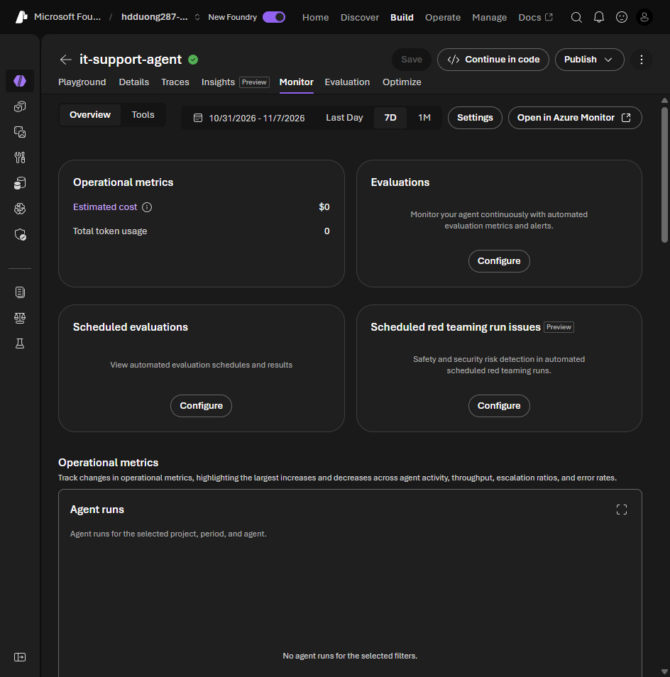

# 06 Test and iterate your integrated agent

[Test and iterate your integrated agent](https://learn.microsoft.com/en-us/training/modules/integrate-foundry-agent-with-m365/6-test-iterate-agent?pivots=text)

- The Foundry playground is not the published app. Retest in Teams: the UI, sign-in, latency, and the published identity's roles. Try desktop, web, and mobile, and have someone else phrase the question.
- No reply in Teams: Bot Service missing or misconfigured, or the zip was not uploaded. Check the Bot Service resource and its logs.
- Tools work in Foundry and fail in Teams: the published identity has no RBAC. Grant the role on the resource the tool uses.
- Users cannot find it: shared scope needs the link, organization scope needs admin approval, or the tenant blocks custom apps.
- Slow replies: long instructions, a tool over a large index, or the network. Watch Foundry metrics (volume, latency, errors, tool calls) and Application Insights traces.
- Fix it in Foundry, retest, republish. Organization scope may need approval again.

The Foundry metrics are on the agent's **Monitor** tab.

The lab's test questions are in [03](03-publish-agent-foundry-portal.md#lab-publish-enterprise-knowledge-agent). Ask each one in Foundry and in Teams, and compare.
