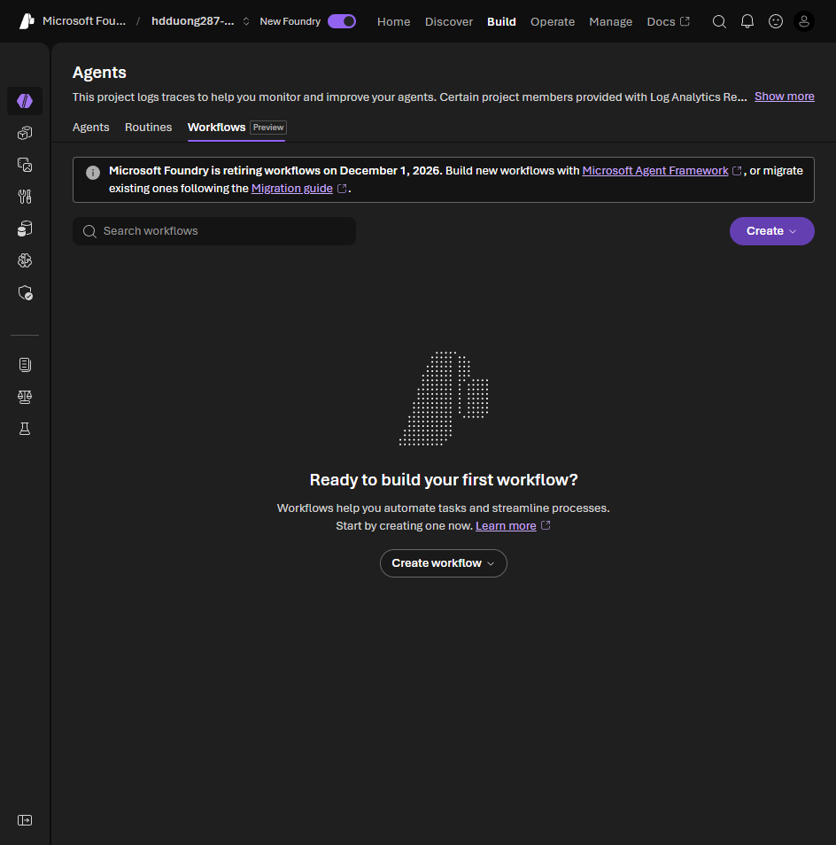

# 02 Understand Workflows

[Understand Workflows](https://learn.microsoft.com/en-us/training/modules/build-agent-workflows-microsoft-foundry/2-understand-workflows?pivots=text)

- A Foundry workflow is a graph of nodes. You draw it. The service runs it and keeps the state. This is the declarative workflow agent, not the Agent Framework SDK in modules 008 and 009.
- A node invokes an agent, checks a condition, sets a variable, or talks to the user.
- Use it when one agent is not enough: classify, decide, then resolve, and pause for a person when confidence is low.

Workflows live on **Build > Agents > Workflows**. The portal banner says Foundry retires workflows on **December 1, 2026**: the visual designer and in-portal runs stop, but exported YAML still runs as a hosted agent. New workflows should use Microsoft Agent Framework (modules 008 and 009). The [migration guide](https://learn.microsoft.com/en-us/azure/foundry/agents/concepts/workflow#migration-guide) also lists Azure Logic Apps (visual) and A2A (one agent calling another).

