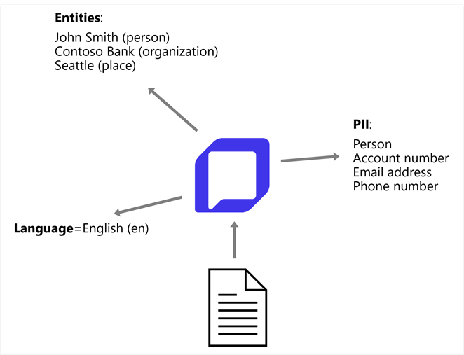

# 02 Provision an Azure Language resource

[Provision a resource for text analysis](https://learn.microsoft.com/en-us/training/modules/analyze-text-ai-language/2-provision-resource)

Azure Language in Foundry Tools reads text. The three tasks in this module:

| Task | What it returns |
| --- | --- |
| Language detection | The language and a confidence score |
| Named entity recognition | People, places, organizations, dates, and similar mentions |
| PII extraction | Personal details, plus a redacted copy of the text |

Sentiment, key phrases, and summarization still exist for old apps. Treat them as deprecated.



Diagram from [Microsoft Learn](https://learn.microsoft.com/en-us/training/modules/analyze-text-ai-language/2-provision-resource) (CC BY 4.0).

- Call it through the REST API or the Python SDK `azure-ai-textanalytics`.
- Auth is a resource **key** or **Microsoft Entra ID**. Use Entra in production.
- The portal home page shows the **project** endpoint. The Language client wants the **resource** endpoint: drop `/api/projects/<project-name>`. The keys are the same.

```text
Project:  https://{resource}.services.ai.azure.com/api/projects/<project-name>
Resource: https://{resource}.services.ai.azure.com
```

## Client

```python
from azure.identity import DefaultAzureCredential
from azure.ai.textanalytics import TextAnalyticsClient

# Entra token for the signed-in identity. Prefer this over a key.
credential = DefaultAzureCredential()
client = TextAnalyticsClient(
    endpoint="https://{resource}.services.ai.azure.com",  # resource endpoint, not the project URL
    credential=credential,
)
```

A key client uses `AzureKeyCredential("...")` instead. Do not put a real key in source.

The hotel-review lab client is in [05](05-extract-personal-information.md#lab-review-each-file).
