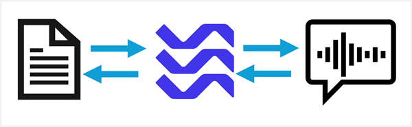

# 02 Create a Speech resource

[Create an Azure Speech resource](https://learn.microsoft.com/en-us/training/modules/create-speech-enabled-apps/2-create-speech-service)

Azure Speech in Foundry Tools is speech-to-text and text-to-speech on a Foundry resource. The Python package is `azure-cognitiveservices-speech`.



Diagram from [Microsoft Learn](https://learn.microsoft.com/en-us/training/modules/create-speech-enabled-apps/2-create-speech-service) (CC BY 4.0).

`SpeechConfig` holds the connection. The lab endpoint is the Cognitive Services host, not the project URL:

```text
https://{resource}.cognitiveservices.azure.com/
```

The Learn samples pass a key. The lab uses Entra:

```python
import azure.cognitiveservices.speech as speech_sdk
from azure.identity import DefaultAzureCredential

speech_config = speech_sdk.SpeechConfig(
    token_credential=DefaultAzureCredential(),
    endpoint="https://{resource}.cognitiveservices.azure.com/",
)
```
