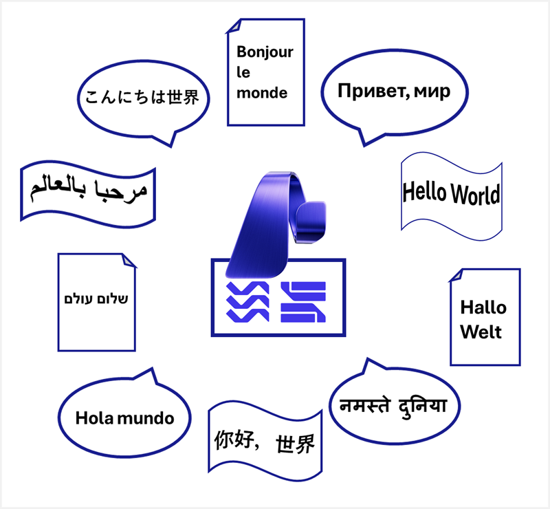

# 02 Translation in Foundry

[Translation options in Foundry](https://learn.microsoft.com/en-us/training/modules/translate-text-speech/2-translation-foundry)

A general model can translate a sentence. A product that must cover many languages uses a Foundry Tools translator.

| Service | Use it for |
| --- | --- |
| **Azure Translator** | Text. Wide language list, plus custom translation models |
| **Azure Speech** | Speech to text in another language, and speech to speech, including several target languages in one recognition |

Both use the Foundry resource endpoint and an SDK. The lab endpoint is `https://{resource}.cognitiveservices.azure.com/`.

Diagram from [Microsoft Learn](https://learn.microsoft.com/en-us/training/modules/translate-text-speech/2-translation-foundry) (CC BY 4.0).
